# relay

[](https://github.com/cube-digital/relay/actions/workflows/ci.yml)

Relay is a plugin for **Claude Code** and **Codex** that keeps long coding sessions inside your usage limits without lowering the quality of the work. It plans each feature so every task runs on the cheapest model that can do it, runs related tasks together in parallel git worktrees, watches your 5-hour usage window, and teaches agents to test like a QA engineer: few tests, each one able to catch a real bug.

It builds on [superpowers](https://github.com/obra/superpowers) by Jesse Vincent, which showed that agents work far better when they plan, test and review in a fixed rhythm. Relay keeps that rhythm and adds what a Pro or Max subscription makes painful: cost, time and limits.

**One-page whitepaper:** [relay-whitepaper.pdf](docs/whitepaper/relay-whitepaper.pdf) covers the problem, the mechanism, and the statistical model behind the forecast (fix rounds as independent per-lane Bernoullis with the exact usage distribution, ratio-estimator calibration, the window walk), plus what is not proven yet.

## Contents

- [The problem](#the-problem)
- [How relay works, in one picture](#how-relay-works-in-one-picture)
- [Core ideas](#core-ideas)
  - [1. A model for every task](#1-a-model-for-every-task)
  - [2. Plans that carry the decisions](#2-plans-that-carry-the-decisions)
  - [3. Lanes and waves](#3-lanes-and-waves)
  - [4. Reviews and the fix loop](#4-reviews-and-the-fix-loop)
  - [5. The usage budget](#5-the-usage-budget)
  - [6. Testing like QA](#6-testing-like-qa)
  - [7. Claude Code and Codex together](#7-claude-code-and-codex-together)
  - [8. Forecast, then run for hours](#8-forecast-then-run-for-hours)
  - [9. The board: what is done, at a glance](#9-the-board-what-is-done-at-a-glance)
- [Workflows, step by step](#workflows-step-by-step)
- [relay HQ: how to use it](#relay-hq-how-to-use-it)
- [Installation](#installation)
- [What's inside](#whats-inside)
- [Configuration](#configuration)
- [FAQ](#faq)
- [Status and roadmap](#status-and-roadmap)
- [Contributing](#contributing)

## The problem

If you build with Claude Code on a subscription, you have probably seen most of these:

- **The 5-hour limit runs out in the middle of a feature.** The work stops at whatever state it was in.
- **Every helper agent runs on Opus.** A subagent inherits your session's model unless something tells it otherwise, and on Pro and Max the default model is Opus.
- **The coordinator is the most expensive seat.** The agent that hands out work re-reads a growing conversation on every turn. In superpowers' own measurements, coordination was about half the cost of a plan run.
- **One worktree per task.** Every task pays for a fresh checkout, a fresh dependency install and a cold cache, and every task needs its own review.
- **Too many tests.** A two-line change comes back with forty new tests, half of which only repeat what the code already says, and the same suite runs six times on the same code.

Here is the difference relay makes to who works on what:

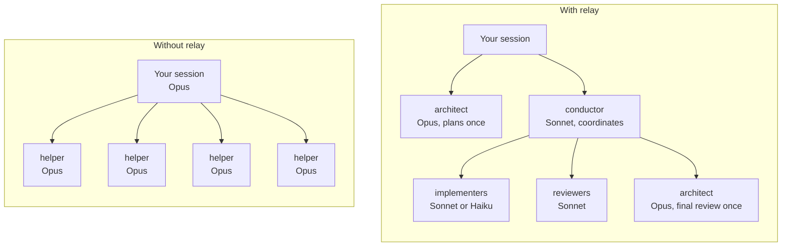

## How relay works, in one picture

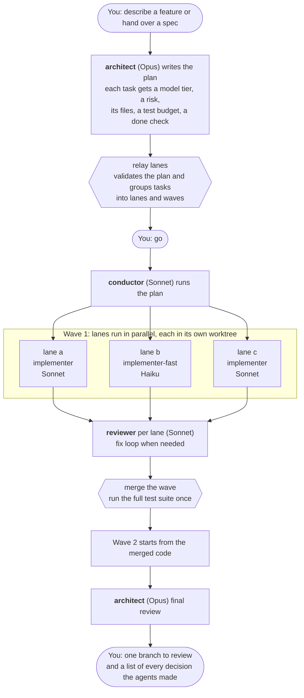

Opus plans the work and reviews the finished branch. Between those two points it only touches the tasks the plan marks as hard and fixes that cheaper models could not finish. Everything else runs on Sonnet or Haiku, and because the expensive judgment calls were already made in the plan, the cheaper models mostly carry out decisions.

## Core ideas

### 1. A model for every task

Relay has three tiers. Each agent role belongs to one, and every task in a plan gets one.

| Tier | Claude Code | Codex | Who uses it |
|---|---|---|---|
| **cheap** | Haiku, low effort | gpt-6-luna, low | `scout` (finds code), `implementer-fast` (types out code the plan already contains) |
| **mid** | Sonnet, medium effort | gpt-6.1-sol, medium | `implementer`, `test-author`, `reviewer`, `conductor`, and any helper started without a model |
| **strong** | Opus, high effort | gpt-6-astra, high | `architect` (plan and final review), `implementer-deep` (hard tasks and escalations) |

The architect picks a task's tier while planning, with simple rules:

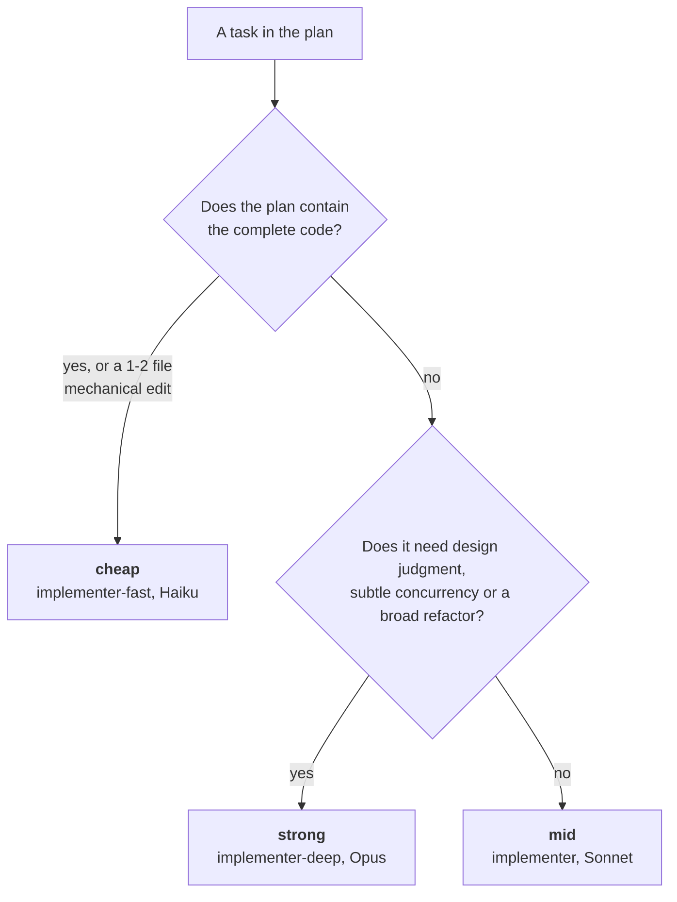

When in doubt the answer is mid. Cheap models often need two or three times as many turns on instructions written in prose, which can cost more than running Sonnet once.

In Claude Code, relay's **mod** (a small module that hooks into Claude Code itself) enforces the routing, so it does not depend on the model remembering a rule:

- a built-in helper started without a model (`general-purpose`, `Plan`) gets Sonnet, and `Explore` gets Haiku, where they would otherwise inherit Opus;
- when the usage budget is tight, any helper headed for Opus is moved to Sonnet, except the architect;
- when the budget is critical, new implementers are refused with a message telling the coordinator to wrap up.

### 2. Plans that carry the decisions

Everything that needs judgment is decided once, at plan time, by the strongest model. A plan is a markdown file for people plus one JSON block for tools:

````markdown
### T2: CSV writer
`writeCsv(rows: ExportRow[]): string` in `src/export/csv.ts`. Header `id,amount,currency`;
amount as `12.34` (two decimals, dot); RFC 4180 quoting.

```relay-plan
{
  "slug": "billing-export",
  "suite": "pnpm test",
  "setup": "pnpm install --frozen-lockfile",
  "tasks": [
    { "id": "T2", "title": "CSV writer", "tier": "mid", "risk": "medium",
      "files": ["src/export/csv.ts", "src/export/csv.test.ts"], "deps": ["T1"],
      "behaviors": ["amounts render with two decimals", "fields with commas or quotes are quoted"],
      "tests": 2,
      "done": "pnpm vitest run src/export/csv.test.ts" }
  ]
}
```
````

Each field has a job:

| Field | What it decides |
|---|---|
| `tier` | Which model builds the task. |
| `risk` | How much testing and review it gets (`low`, `medium`, `high`). |
| `files` | Every path the task touches. Relay groups tasks into lanes from this, so a missing file means a merge conflict later. |
| `deps` | Which tasks must land first. |
| `behaviors` and `tests` | What the task changes, seen from outside, and how many new tests that is worth. |
| `done` | The narrowest command that proves the task works. Never the whole suite. |

`relay lanes <plan>` checks the plan before anything runs: missing fields, unknown dependencies, cycles, a cheap tier on a multi-file prose task, a high-risk task with no test, a low-risk task with three. The full template is in [skills/plan-with-tiers/template.md](skills/plan-with-tiers/template.md).

### 3. Lanes and waves

A **lane** is a group of tasks that touch the same files. A lane gets one git worktree and one implementer, who does its tasks in order with one commit per task. Because the agent stays in the same context, it reads the module once and keeps working, and its prompt cache stays warm.

A **wave** is a set of lanes that can run at the same time. Lanes in a wave share no files, so they never conflict. When a lane depends on another lane's work, it waits for the next wave.

Relay computes this from the plan, with no model involved:

1. Tasks that share a file go in the same lane.
2. A chain of dependent tasks folds into one lane, while it stays small (6 tasks by default), so there is no merge between steps.
3. Waves follow the remaining dependencies between lanes.
4. A wave with too many lanes (4 by default) packs its smallest lanes together.

Here is the example plan from this repository's tests, six tasks for a billing export:

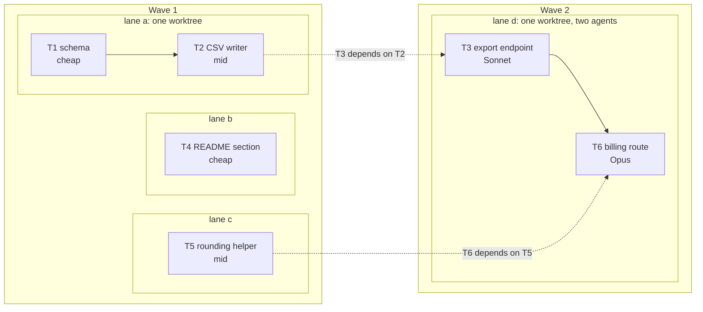

T3 and T6 both edit `src/routes/index.ts`, so they share lane d. They depend on work from lanes a and c, so lane d runs in wave 2. T6 is the one hard task in the plan, so lane d is split: a Sonnet agent does T3, then an Opus agent does T6 in the same worktree. The routine task never runs on the expensive model.

This is what relay prints for that plan:

```text
$ relay lanes docs/relay/plans/2026-10-19-billing-export.md
plan billing-export: 6 tasks → 4 lanes in 2 wave(s)
wave 1
  lane a  [risk medium, new tests ≤ 2]  lane-a=implementer(T1 → T2)
  lane b  [risk low, new tests ≤ 0]  lane-b=implementer-fast(T4)
  lane c  [risk medium, new tests ≤ 1]  lane-c=implementer(T5)
wave 2
  lane d  [risk high, new tests ≤ 3]  lane-d=implementer(T3), then lane-d-s2=implementer-deep(T6)
```

#### Worktrees are reused

Relay keeps a small pool of worktrees per plan. They are created once and dependencies are installed once. Between waves, each worktree is moved to the newly merged code; nobody creates a fresh checkout.

```text
your-repo/                              your checkout, untouched during a run
├── .claude/worktrees/
│   ├── relay-billing-export-int        integration branch; the full suite runs here
│   ├── relay-billing-export-1          slot 1: lane a, then lane d in wave 2
│   ├── relay-billing-export-2          slot 2: lane b
│   └── relay-billing-export-3          slot 3: lane c
└── .relay/runs/billing-export/         briefs, reports, review packages, the ledger
```

The branches end up like this:

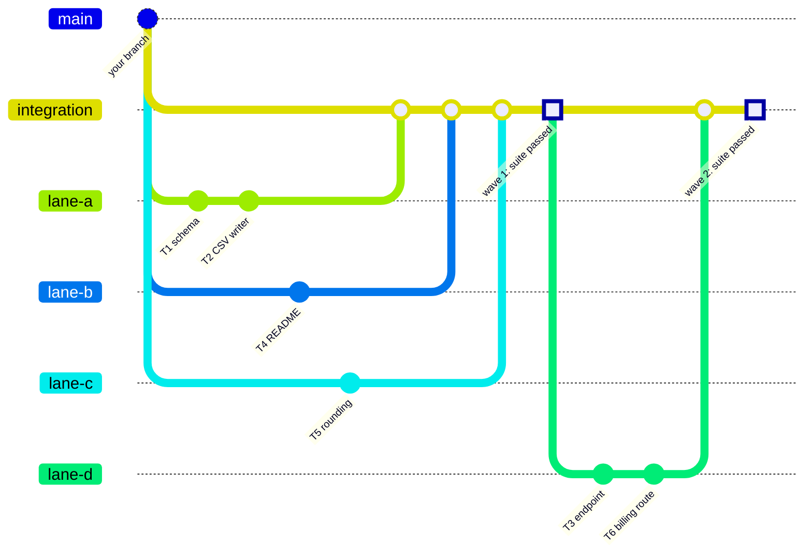

The real branch names are `relay/<slug>/integration` and `relay/<slug>/lane-<id>`. Your own branch is never touched; merging the integration branch into it is your call.

In Claude Code, an agent started with the name `lane-a` is placed in lane a's worktree by relay's mod. In Codex, the dispatch tells the agent which directory to work in.

### 4. Reviews and the fix loop

Every lane is reviewed once, task by task, against the plan and the spec. The reviewer gets a single file with the lane's commits and full diff (`relay worktrees pack`), so it does not spend turns rebuilding the diff with git commands.


Three rules keep this loop from eating the budget:

- Re-reviews only look at the fix, so they cannot wander into new topics.
- Minor findings never enter the loop. They are written down for the final review to triage.
- After five rounds the loop stops. A loop that has not converged by then is a problem in the plan, and more rounds will not fix it.

Every decision the conductor makes on your behalf is written to the ledger as `Ruling: what — why — what it costs if wrong`, and the final report lists all of them.

### 5. The usage budget

Relay's mod reads the same 5-hour and weekly figures Claude Code shows you in `/usage`, and writes them to `~/.relay/budget.json` so that `relay budget` and the skills can read them.

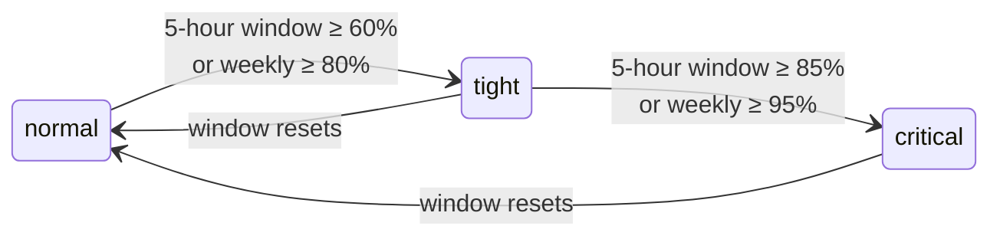

| Level | What changes |
|---|---|
| **normal** | Every task runs on its planned tier. |
| **tight** | Opus is kept for the final review. Anything else headed for Opus runs on Sonnet. The conductor prefers cheap tiers where the plan holds complete code, and can send reviews to Codex. |
| **critical** | No new implementation starts. Lanes already running finish their tasks and fix rounds, the wave merges, and the conductor writes a handoff note. Claude Code can wait for the reset and pick up from there. |
| **unknown** | No reading yet (a fresh session, or Codex). Relay behaves as if the budget were tight. |

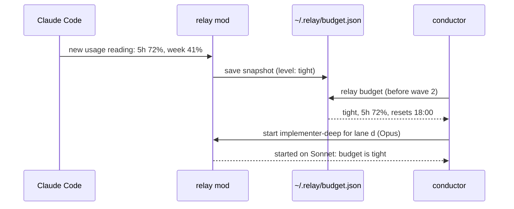

In your own session, relay also adds one line to your next prompt whenever the level changes, so the model you talk to knows where the budget stands.

The thresholds are starting points. Watch `/usage` for a week of real work and adjust them in `config/routing.json`.

### 6. Testing like QA

Coding agents tend to over-test. In recent studies, most tests written by agents had weak assertions or none, and re-running tests on unchanged code was one of the most common wastes in agent sessions. In one small experiment, making an agent write a failing test before every change cost three to eight times more tokens with no measurable gain in quality. [docs/design.md](docs/design.md#4-testing-evidence) has the sources.

Relay treats tests the way a QA engineer would: each test has to be able to catch a real bug that nothing else catches.

**A test budget per task, from its risk:**

| Risk | Examples | New tests |
|---|---|---|
| low | internal refactor, docs, config | 0 or 1. Types and existing tests usually cover it. |
| medium | user-visible behavior | One per behavior listed in the plan. |
| high | money, data loss, security, concurrency, migrations | One per behavior, plus boundary values and error cases, or one property-based test. Mutation testing on the changed lines. |

**Tests come from the spec, written by someone else.** For medium and high-risk lanes, a `test-author` agent writes the acceptance tests from the spec before the code exists. Tests written after reading the code tend to copy its bugs. Relay then protects those files: the implementer cannot edit, skip or weaken them.

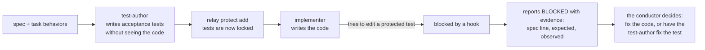

**Verification goes from narrow to wide, and only the last step is the full suite:**

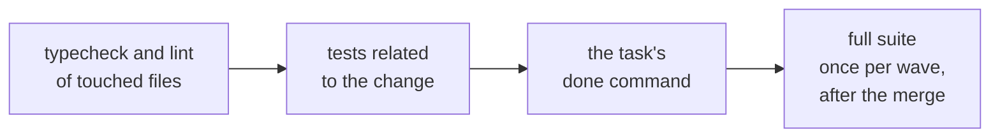

**The same test never runs twice on the same code.** A hook fingerprints the test command together with the exact state of the code. If nothing changed since the last run, the result cannot change either, so the run is refused and the agent gets the previous output back:

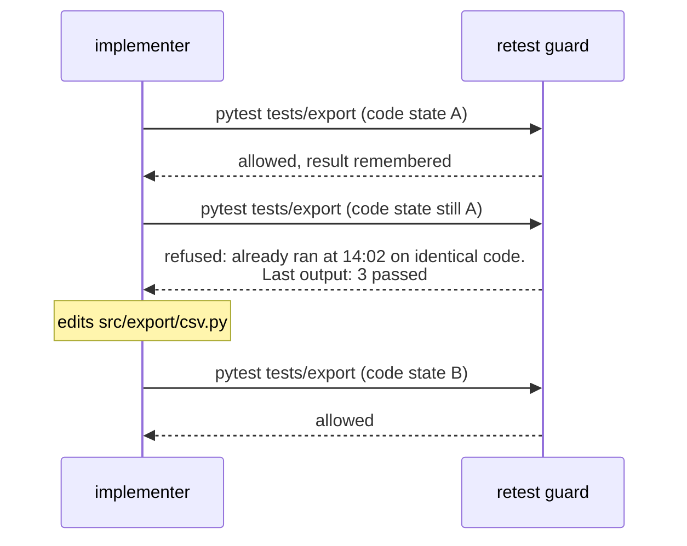

For a test that is really flaky, the agent can prefix the command with `RELAY_RERUN=1` and has to explain why in its report.

**Every report says what happened to the tests:** how many were added and removed, one line per new test naming the behavior it guards, and the commands that ran with their results. Reviewers delete tests that only mirror the code, assert nothing, or duplicate another test.

The full rules are in [skills/qa-mindset/SKILL.md](skills/qa-mindset/SKILL.md).

### 7. Claude Code and Codex together

Relay keeps one source for both tools. Skills are shared word for word, and agents and hooks are generated for each tool from `roles/` and `config/routing.json`.

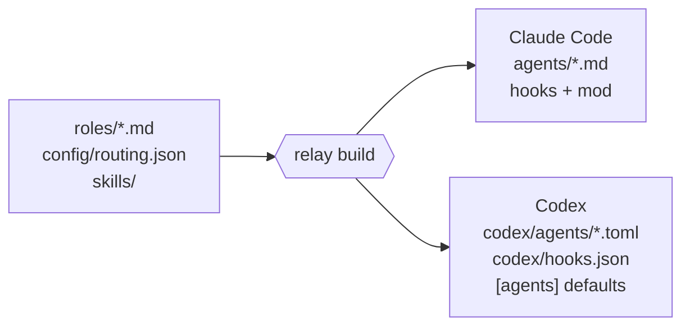

Claude and Codex have separate usage windows, so you can split the work between them. A common split: Claude plans and builds, Codex reviews read-only. A second model family also has different blind spots than the first, which makes it a better reviewer of the first one's code.

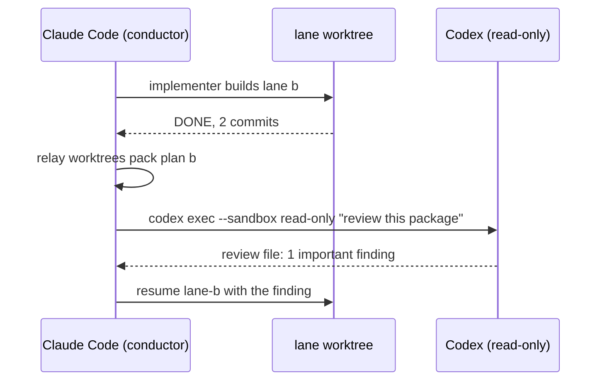

### 8. Forecast, then run for hours

After the plan, before anyone says go, `/relay:forecast` says what the run will take (the plan-with-tiers skill also runs it for you before it hands the plan over). Agents, worktrees and parallelism are exact, computed from the plan. Usage and time come from your own past runs once you have any; until then relay uses placeholder rates and says so on every line that depends on them.

```text
> /relay:forecast docs/relay/plans/2026-10-19-password-reset.md
forecast for password-reset: 6 tasks · 3 lanes · 2 wave(s)
agents       ~11 starts (3 reviewer, 2 implementer, 2 test-author, 1 conductor, 1 architect,
             1 implementer-fast, 1 implementer-deep), plus ~1.8 fix round(s) on resumed agents
parallel     up to 2 lane(s) at once (plan allows 2, cap 4)
worktrees    3 (2 lane slot(s) reused across waves + 1 integration)
usage        ~31.7% of a 5h window ± 2.9% from fix rounds — 24.6 units of work + 7.1 expected in fix rounds,
             at 1.00% per unit — PLACEHOLDER rate, not your data: run a plan, then `relay calibrate`
windows      ~1 five-hour window(s) at the 85% stop line — from placeholder rates
time         ~2h 3m of work — from placeholder rates
  wave 1: ~11.1% · ~41m · window 1
  wave 2: ~20.6% · ~1h 22m · window 1
```

**How it learns.** Every ledger line is stamped with the usage reading at that moment and the time the 5-hour window resets, for example `[5h 23.4% resets 16:30 · 7d 41%]`. When a wave merges, the difference between the wave's start stamp and its merge stamp is one sample: this much of the window for this much expected work, reviews and fix rounds included. `/relay:calibrate <plan>` collects the samples into `~/.relay/calibration.json`, and the next forecast uses them; run-lanes does this on its own at the end of a run. A wave during which the window reset is dropped, never guessed. After two or three plans the numbers are yours.

**The 5-hour limit is a quota. Relay crosses it; nothing dodges it.** Optimizing tokens fits more work into each window and leaves the window itself in place. A long plan passes through several windows, and `/relay:marathon` makes that happen without you:

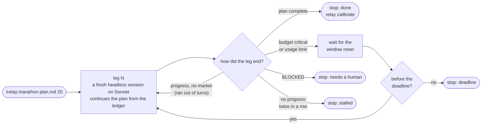

Each leg is a short `claude -p` session with an empty context, so a 20-hour run never carries a 20-hour conversation: the state lives in the ledger, the lane branches and the worktrees. Legs run with `--permission-mode auto --permission-prompts none`, the documented pattern for unattended work: a classifier approves routine actions, and anything that would need a person is refused, so the run never hangs on a prompt. At the end you get the same thing as after an interactive run: one integration branch, the test counts, and every ruling the agents made.

**Where a marathon runs.** `/relay:marathon plan.md 20` starts it from the chat as a background task of the session. You can keep working in the same session; `/relay:marathon status` shows the current leg or how long until the window resets, and `/relay:marathon stop` ends it after the current leg (`stop now` ends that leg too). A background task lives as long as the session, so keep Claude Code open and the computer awake. If the session closes anyway, the same command continues from the ledger. On macOS, `/relay:marathon plan.md 20 terminal` opens the run in its own Terminal window instead, and it keeps going after you close Claude Code.

What a marathon can and cannot promise: any plan, whatever its size, keeps advancing until it is done, with as much work as possible in each window. What changes with complexity is the number of windows. The real ceiling is the weekly limit; `relay forecast` warns when a plan does not fit in what is left of it, and the way past that ceiling is a second quota (Codex, or paid extra usage), not a trick.

### 9. The board: what is done, at a glance

Once a plan exists, every task has a traffic light: **grey** planned, **yellow** in progress, **green** done, **red** blocked. Within a busy lane, the tasks waiting for the one before them are hollow grey (queued).

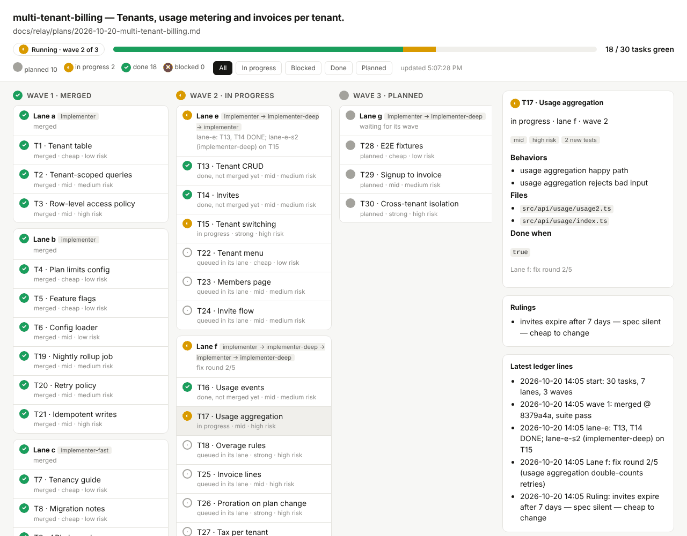

The lights are computed, not reported by an agent. A task turns green when its own commit (`T3: ...`) is on its lane branch, and stays green once merged into the integration branch; the tests a test-author writes for it do not count. A lane turns red when its latest ledger line says BLOCKED or its wave's suite failed. Every `relay ledger` and `relay worktrees` call refreshes the board, so it moves as the run moves.

Three places show it:

- **`/relay:board`** prints it in the chat and opens the roadmap page in your browser, which reloads itself while the run goes. Click a task for its files, behaviors, test budget and done check; filter by light.
- **A band above the prompt** in Claude Code, while a run is going: one dot per task and the count of green ones, with a button that opens the pane.
- **`/relay-board`** opens the whole board in a pane beside the chat.

From a terminal: `relay board <plan> --html --open`.

## Workflows, step by step

The examples below show what you type and what relay does. Agent output is shortened.

### Workflow 1: a new feature, end to end

**1. Describe the feature.** Give relay a spec, or just say what you want:

```text
/relay:plan CSV export of invoices for the billing page, plus a rounding helper
```

Relay scouts the code, asks at most three questions that change the plan (here: which currencies, and whether totals round per line or per invoice), and writes a one-page spec with the behaviors that will become tests.

**2. The architect writes the plan** (on Opus) to `docs/relay/plans/2026-10-19-billing-export.md`, runs `relay lanes` on it, fixes anything it reports, and you get one line per task, the lanes and waves, and the forecast:

```text
plan billing-export: 6 tasks → 4 lanes in 2 wave(s)
wave 1
  lane a  [risk medium, new tests ≤ 2]  lane-a=implementer(T1 → T2)
  lane b  [risk low, new tests ≤ 0]  lane-b=implementer-fast(T4)
  lane c  [risk medium, new tests ≤ 1]  lane-c=implementer(T5)
wave 2
  lane d  [risk high, new tests ≤ 3]  lane-d=implementer(T3), then lane-d-s2=implementer-deep(T6)
```

Read the plan. This is the cheapest moment to change your mind.

**3. Say go.**

```text
/relay:run
```

The conductor (Sonnet) takes over in the background and works without stopping to check in; `/relay:status` shows where it is:

```text
relay budget                         → budget: normal — 5h 18%, 7d 22%
relay worktrees sync <plan> --wave 1 → 3 worktrees created, briefs written
test-author for lane a (risk medium) → 2 acceptance tests, protected
lane-a, lane-b, lane-c dispatched in parallel
lane-b DONE → reviewer: clean
lane-c DONE → reviewer: 1 important finding → fix round 1 → addressed
lane-a DONE → reviewer: clean
relay worktrees merge <plan> --wave 1 --suite → 4 commits merged, suite passed
relay worktrees sync <plan> --wave 2 → slot 1 reused for lane d
lane-d (Sonnet: T3) DONE → lane-d-s2 (Opus: T6) DONE → reviewer: clean
relay worktrees merge <plan> --wave 2 --suite → suite passed
architect: final review of the whole branch → 1 deferred minor to fix before merge
```

**4. Read the report.** You get the branch `relay/billing-export/integration`, the waves and lanes with their status, how many tests were added and removed, and every ruling the conductor made, each with its reason and what it costs if it was wrong. Review the branch like any pull request and merge it when you are happy.

### Workflow 2: a small change, no plan

Not everything needs lanes. For a bug fix or a one-file change, keep talking to your agent as usual:

> The invoice total is off by a cent when a line has three decimals. Fix it.

Relay still shapes the work:

- If the agent sends a helper to look around, the helper runs on Haiku (`Explore`) or Sonnet, not Opus.
- The `qa-mindset` skill asks for one regression test that reproduces the bug, with the expected value taken from the bug report, never from running the code.
- Verification stays narrow: the related test file, then the typecheck. The retest guard stops the agent from re-running the suite "to be sure".

### Workflow 3: the budget runs low mid-run

You are halfway through a large plan and the 5-hour window reaches 86%.

1. The mod marks the budget **critical**. The conductor sees it when it checks `relay budget` after a lane finishes, and any new implementer it tries to start is refused with the same message.
2. Lanes already working finish their current tasks and fix rounds; nothing new starts.
3. The conductor merges what is done, then writes `.relay/runs/<slug>/HANDOFF.md`: the goal, the branch and its last commit, what is finished and verified, what is in flight, the next three steps, and every ruling so far.
4. When the window resets, start a fresh session and say:

> Read .relay/runs/billing-export/HANDOFF.md and continue from "Next".

The ledger and the lane branches are on disk, so nothing depends on the old conversation. Lanes that already finished are never dispatched again.

### Workflow 4: a protected test looks wrong

The implementer of lane a cannot make the acceptance test for "amounts render with two decimals" pass. The test expects `12.3`, the spec says `12.30`.

1. The implementer tries to change the test. The protect hook refuses the edit.
2. It reports `BLOCKED` with the evidence: the spec line, what the test expects, what the code produces.
3. The conductor compares that against the spec, rules that the test is wrong, and records the ruling.
4. It runs `relay protect remove` for that file, has the test-author fix it, protects it again, and resumes the implementer.

The implementer never decides on its own that a test is wrong, and the decision ends up in the final report.

### Workflow 5: Claude builds, Codex reviews

With Codex installed, the conductor sends reviews of high-risk lanes to Codex, and all reviews once the budget is tight:

```bash
codex exec --sandbox read-only -o .relay/runs/billing-export/lane-d.codex-review.md \
  "Review per roles/reviewer.md: brief <path>, report <path>, package <path>"
```

The review lands in a file, the conductor reads its verdicts, and the fix loop continues as usual. The review is paid from your Codex window.

### Workflow 6: running relay inside Codex

The same skills work in Codex. Invoke them by name, for example `$plan-with-tiers` and `$run-lanes`, or just describe what you want. The conductor spawns `relay-implementer`, `relay-reviewer` and the other agents installed by `relay setup codex`, always naming the model and reasoning effort. Each lane's dispatch starts with the absolute path of its worktree.

### Workflow 7: run for 20 hours while you sleep

You have a large plan, say 30 tasks in 5 waves, and you want it done by morning. Everything happens in the Claude Code chat.

**1. Read the forecast.**

```text
/relay:forecast docs/relay/plans/2026-10-19-big-feature.md
```

If it says the plan does not fit the weekly limit, split the plan or let Codex take the reviews. If the time estimate is longer than your night, that is fine: the marathon stops at the deadline with the ledger showing where it got to.

**2. Start it.**

```text
/relay:marathon docs/relay/plans/2026-10-19-big-feature.md 20
```

Claude does a dry run first: it shows the forecast and refuses if the main checkout has uncommitted changes or the plan has errors. Then it starts the marathon as a background task and tells you where it runs. Leave Claude Code open and the computer awake (on a laptop: plugged in, lid open or sleep disabled). Add `terminal` at the end, on macOS, to run it in its own Terminal window instead.

**3. Look in whenever you like.**

```text
/relay:marathon status
```

```text
marathon big-feature: running · pid 48211 · waiting for the usage window until 2026-10-20 03:02 (1h 31m from now)
deadline 2026-10-20 18:04 (16h 33m left) · model sonnet · permission auto
legs 1: paused · api-equivalent $14.20
last  leg 1 paused: budget critical [5h 86% · 7d 38%]
ledger
  - 2026-10-20 01:12 [5h 71% · 7d 35%] wave 2: merged @ 9c41e0a, suite pass
  - 2026-10-20 01:30 [5h 86% · 7d 38%] handoff: wave 3 lanes a, b in flight at critical; next leg resumes them
```

The full log, one line per event, is in `.relay/runs/big-feature/marathon.log`:

```text
22:04 marathon start: big-feature, 20h, deadline 18:04, model sonnet, permission auto
22:04 leg 1: starting
01:31 leg 1: paused — budget critical (api-equivalent $14.20) [5h 86% · 7d 38%]
01:31 waiting until 03:02 (+90s) for the window to reset: budget critical
03:04 leg 2: starting
06:48 leg 2: progress — leg ended with progress; continuing
06:48 leg 3: starting
07:40 leg 3: done — merged (api-equivalent $3.10) [5h 41% · 7d 52%]
07:40 marathon stop: plan complete
```

Leg 1 worked until the window was nearly spent, merged what was clean and wrote a handoff. The marathon waited for the reset and started leg 2 with an empty context, which picked up from the ledger. Leg 2 ran out of its turn budget mid-wave, so leg 3 continued at once. Each leg is its own headless session with its own session id, recorded with its cost and usage reading in `.relay/runs/big-feature/marathon.json`.

**4. In the morning.** When the background task ends, Claude reports the outcome, the waves merged, what is left and the rulings worth a look, and calibrates the forecast from this run. Review `relay/big-feature/integration` like a pull request.

**From a terminal instead.** With the `relay` command installed in your shell (see [In your own terminal](#in-your-own-terminal)), `relay marathon <plan> --hours 20` does the same under `tmux` or `screen`, and `--status` and `--stop` work the same way.

## relay HQ: how to use it

relay HQ is a local page in your browser for all of your relay work. It shows, across every repository you add:

- what is waiting on you;
- what is running;
- every plan down to the task;
- what your Claude Code and Codex can reach: connectors, API keys, skills and agents.

From the same page you can start work on either tool. Everything on it is read from files on disk, so looking at it costs no tokens. Only a launch spends usage, and it asks first.

### 1. Start it

- **Claude Code:** `/relay:hq`.
- **Codex, or any terminal:** `relay hq`.

Your browser opens on `http://127.0.0.1:4747`. Running it again reuses the server that is already up.

```text
relay hq                  start (or reuse) the server and open the browser
relay hq --port 4800      use another port (the next 10 are tried when one is taken)
relay hq --no-open        print the URL instead of opening it
relay hq stop             stop the server
```

The URL carries a fresh token every time the server starts. Open HQ through `relay hq`, not from a bookmark.

### 2. Add your repositories

Nothing is added for you: you choose which repositories HQ shows. A **project** is a named group of repositories, for example a client's `web`, `api` and `infra`.

- **In the page:** **Add repository** on Home or on a project's page. Type the path, pick a project (or create one), Add.
- **In a terminal:**

```bash
relay hq add ~/code/polaris-web --project Polaris
```

Any path inside a repository works, including a lane worktree: HQ registers the main checkout. A repository can belong to one project at a time.

- **A project's ⋯ menu** (on Home and on its page) has Rename, Add repository and Delete project. Deleting a project moves its repositories to Unassigned; nothing on disk changes.
- **To move a repository** to another project, use the selector on its card.
- **Hide** keeps a repository off the dashboard; `relay hq rm <path>` forgets it.

### 3. Read Home from the top

| Section | What is in it |
|---|---|
| **Waiting on you** | A blocked lane (with its fix round). A wave whose suite failed. A marathon that ended BLOCKED. A finished plan whose integration branch is not merged yet. Red CI on a branch or PR. A PR asking for your review. Each row opens the place to act. |
| **Running now** | Every running plan and every launch from HQ: progress bar, wave, harness, model, elapsed time. |
| **Projects** | One line per project: repositories, running plans, its worst signal. |
| **Activity** | Ledger lines, commits by relay agents and launches, grouped by repository and plan. Only the newest group starts open. An open group shows its latest three events, and **Show N more** reveals the rest. Groups stay as you leave them while the page refreshes. |

GitHub rows need the `gh` CLI, signed in (`gh auth login`); without it those parts say "not connected". The budget in the top bar comes from your latest Claude Code session; "budget unknown" means there is no recent reading yet.

### 4. Go down to the task

**Home → project → plan → task.**

- **A project's page** shows one card per repository: branch, uncommitted files, ahead/behind, lane worktrees left on disk, its plans with their progress, and its open PRs with CI.
- **A plan** opens its board, the same as `/relay:board`: waves, lanes and a light on every task.
- **A task** opens its panel:
  - tier, risk, test budget, behaviours, files, done check;
  - the reviewer's latest findings for its lane;
  - links to the brief, the report, the review package and the worktree;
  - **Open in editor**.

### 5. Start work from the page

| Button | Where | What it starts |
|---|---|---|
| **+ New plan** | a repository card | `/relay:plan` with your goal; runs without questions and writes its assumptions into the spec |
| **Run** | a plan | the plan, start to finish; a blocked or quiet plan resumes from its ledger |
| **Marathon** | a plan | `relay marathon` for N hours (Claude Code only) |
| **Run a skill** | Home | one skill with your prompt |
| **Status**, **Stop** | a plan, a launch | where it is; stop a launch |

Every button opens a dialog first:

- **Choose** the harness (Claude Code or Codex), the model and effort (default: the `mid` tier from `config/routing.json`) and the permission mode.
- **Check** the forecast, the current budget and the exact command.
- **Then** press **Start**, or **Copy command** to run it yourself.

**Start is disabled, with the reason, when:**
- the plan is already running;
- the budget is critical;
- the harness is not installed;
- a field is out of range.

**Launches** lists everything started from HQ, with its log, its result and, for runs, the outcome line (`DONE`, `PAUSED` or `BLOCKED`). Progress shows up on the plan's board as the run writes its ledger.

**For Codex launches:**
- install `codex`;
- install relay's agents in that repository: the dialog offers **Set up Codex**, which runs `relay setup codex <repo>`.

Marathon is Claude Code only for now.

### 6. The Brain

| Tab | What it shows |
|---|---|
| **Connectors** | One widget per connector, with its source, tool count, status and harness. Filters: All, Claude, Codex, Needs action. Below: API connections (services used through a key, such as Exa, Parallel or OpenAI) and the CLIs on your PATH. |
| **API keys** | Every key a connector or skill needs: set, missing, or written into a file. Values are never shown. |
| **Skills** | Every skill relay, Claude Code and Codex can load, with its description, what references it and, for Claude, how often it was used. |
| **Agents** | relay's roles with their tier and model on both tools, their tools and where they are generated from, plus your other agents. |
| **How relay is wired** | relay's pipeline step by step (from `config/flow.json`), what is generated from what (and whether it is in sync), and which command uses which skill and agent. |

**Where connectors come from:**
- **Read from disk, always current:**
  - `~/.claude.json` (user scope);
  - installed Claude Code plugins;
  - `~/.codex/config.toml`.
- **claude.ai account connectors** (Linear, Slack, Notion, and so on) are not on disk. To record them, run `/relay:connectors` once in a Claude Code session. **Refresh** in the Connectors tab runs it for you in the background, but a background run may miss connectors that only the desktop app has; in that case run it in an open session.

**Verify** asks Claude Code and Codex for each server's live status (`claude mcp list`, `codex mcp list`).

### Good to know

- **Security:**
  - the server listens on 127.0.0.1 only;
  - every API call needs that start's token, and requests from other sites are refused;
  - the page sends only intents, never commands: the server builds every command itself.
- **Files:** `~/.relay/hq/` (mode 0700) holds:
  - `registry.json` (your projects and repositories);
  - `server.json` (port, pid, token; mode 0600);
  - `connectors.json` (the last connector snapshot per tool);
  - `launches/<id>/` (each launch's command, log and result).
- **Not in this version:**
  - token usage per project;
  - connectors defined inside a single project (`<repo>/.mcp.json`);
  - marathon on Codex;
  - a shared team server.
- **Trying it from a branch, before a release:** the `relay` on your PATH is the installed plugin, so run the checkout directly:

```bash
claude --plugin-dir ~/Workspaces/relay
```

```bash
node ~/Workspaces/relay/bin/relay hq
```

## Installation

You need a recent **Claude Code** (run `claude update`), **git**, and **Node 20 or newer**. Relay's hooks and its `relay` command run on Node.

### Claude Code

**1. Add the marketplace and install the plugin.** Inside Claude Code:

```text
/plugin marketplace add cube-digital/relay
/plugin install relay@relay
```

The same from a terminal:

```bash
claude plugin marketplace add cube-digital/relay
claude plugin install relay@relay
```

**2. Restart Claude Code** (or run `/reload-plugins`), then run `/plugin`. You should see relay in the list and the line `1 mod active · relay`. The mod is the part that routes models and reads your usage budget. Relay is tested on Claude Code 2.1.303; on an older version the mod may not load, and everything else (skills, agents, hooks) still works without it.

**3. Set up each repository once.** Relay relies on two settings that a plugin is not allowed to set for itself. Open Claude Code inside the repository and ask:

> Run `relay setup claude --write-project`.

The `relay` command ships inside the plugin: Claude runs it for you, and the `/relay:` commands below wrap the parts you use yourself. If you prefer to do it by hand, add this to the repository's `.claude/settings.json`:

```json
{
  "worktree": { "baseRef": "head" },
  "subagentPromptCacheTtl": "1h"
}
```

The first setting makes lane worktrees branch from your current branch (by default they would start from `origin`'s main branch). The second keeps a lane's prompt cache warm for an hour while it waits for a review (the default is five minutes).

**4. Try it.** In the same session:

```text
/relay:budget
```

After your first message in a session it prints your 5-hour and weekly usage. Then describe a feature and say "plan this with relay".

#### For a whole team

Install with project scope from inside the repository:

```bash
claude plugin install relay@relay --scope project
```

This records relay in the repository's `.claude/settings.json`. Commit that file, and everyone who opens the repository in Claude Code is offered the same plugin. Commit the two settings from step 3 at the same time.

#### Updating and removing

```bash
claude plugin marketplace update relay      # fetch the latest version
claude plugin update relay@relay            # install it, then restart Claude Code
claude plugin uninstall relay@relay         # remove relay
```

#### In your own terminal

Optional. Everything works from the chat; install the command in your shell only to run marathons under `tmux`, in CI, or by hand:

```bash
npm install -g github:cube-digital/relay
relay --help
```

### Codex

**1. Install the skills** from the marketplace:

```bash
codex plugin marketplace add cube-digital/relay
```

Then open Codex, run `/plugins` and enable relay.

**2. Install the `relay` command.** Codex plugins cannot ship a command-line tool, so clone the repository and link it:

```bash
git clone https://github.com/cube-digital/relay ~/relay
cd ~/relay && npm link
```

**3. Set up each project once:**

```bash
relay setup codex /path/to/your/project
```

This writes three things into the project's `.codex/` folder: one agent file per role with its model and reasoning effort, a `hooks.json` with relay's hooks, and an `[agents]` default so a helper started without a model never inherits the most expensive one.

**4. Trust the hooks.** Open Codex in the project and approve relay's hooks with `/hooks`. Codex does not run project hooks until you do.

### Trying relay without installing it

To try a local copy (or your own fork) for one session:

```bash
git clone https://github.com/cube-digital/relay ~/relay
cd /path/to/your/project
claude --plugin-dir ~/relay
```

Nothing is installed; the next session starts without relay.

## What's inside

### Commands in Claude Code

Type `/relay` in Claude Code to see them. They run only when you call them, so they cost no context until then.

| Command | What it does |
|---|---|
| `/relay:plan <what to build \| spec>` | From an idea to a plan: scouts the code, asks at most three questions, writes a short spec, has the architect write the plan, then shows the tasks, lanes and forecast. Writes no code. |
| `/relay:run [plan]` | Runs the plan now: the conductor works through the waves in the background while you keep using the session. |
| `/relay:status [plan]` | Where a run is: waves, lanes, fix rounds, rulings, budget, and the marathon if one is running. |
| `/relay:board [plan]` | The roadmap as traffic lights, in the chat and as a page in your browser that follows the run. |
| `/relay-board` | The same board in a pane beside the chat; a band above the prompt shows it while a run is going. |
| `/relay:forecast [plan]` | Agents, worktrees, parallel lanes, usage windows and hours for a plan, before you run it. |
| `/relay:lanes [plan]` | The blueprint: which tasks share a lane and which lanes run in parallel, wave by wave. |
| `/relay:marathon <plan> <hours> [terminal]` | Runs the plan unattended across usage windows, as a background task or in its own Terminal window. |
| `/relay:marathon status \| stop [now]` | Where a marathon is (leg, wait, last outcome, ledger tail), or end it. |
| `/relay:calibrate [plan]` | Learns your account's real usage and speed from a finished run; without a plan, shows the current calibration. |
| `/relay:budget` | The 5-hour and weekly level relay routes by: normal, tight or critical. |
| `/relay:hq` | Opens relay HQ in your browser: what is waiting on you across every project, running plans, each plan's board down to the task, launches on Claude Code or Codex, and the Brain (connectors, API keys, skills, agents, how relay is wired). Looking costs no tokens. |
| `/relay:connectors` | Records which MCP connectors this session reaches, including claude.ai account connectors, for HQ's Brain. |

Without a plan argument, they use the newest plan in `docs/relay/plans/`. The usual path is `/relay:plan` → read the plan → `/relay:run` (or `/relay:marathon` when it spans more than one window) → `/relay:status` while it runs. Plain words work too: "plan this with relay", then "run it".

### Skills

| Skill | Used when |
|---|---|
| `using-relay` | At the start of every session. Loaded automatically; sets the rules below in about 2 KB. |
| `plan-with-tiers` | Turning a spec into a plan with tiers, risk, files, test budgets and done checks. |
| `run-lanes` | Executing a plan: waves, lanes, reviews, fix loops, merges, the final review. |
| `qa-mindset` | Writing, running or reviewing tests. |
| `handoff` | The budget turns critical, the context gets long, or work moves to a new session. |
| `relay-setup` | Installing relay, long unattended runs, or checking why routing or lanes misbehave. |

### Agents

| Agent | Tier | Job |
|---|---|---|
| `scout` | cheap | Finds files, symbols and call sites. Returns paths and line numbers, never whole files. |
| `implementer-fast` | cheap | Transcribes code the plan already contains. Stops when the plan is unclear. |
| `implementer` | mid | Builds a lane task by task in its worktree, one commit per task. |
| `implementer-deep` | strong | Hard tasks, and fix rounds 4 and 5 when others got stuck. |
| `test-author` | mid | Writes acceptance tests from the spec without reading the implementation. |
| `reviewer` | mid | Read-only. Reviews a lane per task against the spec, and audits its tests. |
| `architect` | strong | Writes the plan and does the final review of the branch. |
| `conductor` | mid | Runs a whole plan, so coordination happens on Sonnet. |

Every worker writes its full report to a file and returns at most eight lines: a status (`DONE`, `DONE_WITH_CONCERNS`, `NEEDS_CONTEXT` or `BLOCKED`), its commits, its test counts, the report path and any concern. The conductor's context stays small however long the run.

### Hooks and the mod

| Piece | Runs in | What it does |
|---|---|---|
| `session-start` | Claude Code, Codex | Loads the `using-relay` rules and the current budget level into every new session. |
| `retest-guard` | Claude Code, Codex | Refuses a test command on code that has not changed since its last run. |
| `protect-tests` | Claude Code, Codex | Refuses edits, from editors or the shell, to protected acceptance tests. |
| mod (`hooks/register.ts`) | Claude Code | Model routing, budget readings, budget caps, putting `lane-*` agents into their worktrees, and the board's band and pane. |

All hooks fail open: if one crashes, the tool call goes ahead as if relay were not installed.

### The `relay` command

```text
relay lanes <plan> [--write]                  validate a plan, show lanes and waves, write briefs
relay forecast <plan>                         agents, worktrees, usage windows and hours the run will take
relay board <plan> [--html] [--open]          traffic lights for every task, lane and wave; the roadmap page
relay hq [--port N] [--no-open]               the command centre in your browser; reuses a running server
relay hq stop | add <path> [--project P]      stop it; register a repository, optionally into a project
relay hq hide | unhide | rm <path>            keep a repository off the dashboard, or forget it
relay hq connectors --record [--harness H]    store a connector snapshot (JSON on stdin)
relay marathon <plan> --hours N [--dry-run]   run the plan unattended across usage windows
relay marathon <plan> --status | --stop [--now]  where a marathon is, or end it
relay calibrate <plan> | --show               learn real usage and time rates from a finished run
relay worktrees sync <plan> --wave N          create or reuse lane worktrees from the integration head
relay worktrees pack <plan> <lane> [--from]   review package for a lane, or for a fix
relay worktrees pack <plan> --final           package of the whole branch for the final review
relay worktrees merge <plan> --wave N --suite merge a wave, then run the full suite once
relay worktrees status | clean <plan>         what each lane is doing; remove the worktrees
relay ledger <plan> ["line"] [--rulings]      the run's memory on disk
relay protect add | remove | list <paths>     acceptance tests the implementers may not change
relay budget [--codex] [--json]               5-hour and weekly level: normal, tight, critical
relay build [--check]                         regenerate agents and hooks for both tools
relay setup claude | codex                    settings a plugin cannot set for itself
```

Claude runs these for you; the commands above are the ones worth calling yourself. Mechanical work runs in this command and costs no tokens: checking plans, grouping lanes, managing worktrees, building review packages.

## Configuration

Everything about models and limits lives in [config/routing.json](config/routing.json):

```jsonc
{
  "tiers": {
    "cheap":  { "claude": { "model": "haiku",  "effort": "low" },    "codex": { "model": "gpt-6-luna",  "effort": "low" } },
    "mid":    { "claude": { "model": "sonnet", "effort": "medium" }, "codex": { "model": "gpt-6.1-sol", "effort": "medium" } },
    "strong": { "claude": { "model": "opus",   "effort": "high" },   "codex": { "model": "gpt-6-astra", "effort": "high" } }
  },
  "unrouted": { "general-purpose": "mid", "claude": "mid", "Plan": "mid", "Explore": "cheap" },
  "budget": {
    "fiveHour": { "tight": 60, "critical": 85 },
    "sevenDay": { "tight": 80, "critical": 95 },
    "tight":    { "capStrongTo": "mid", "exempt": ["architect"] },
    "critical": { "capStrongTo": "mid", "denyNewSpawns": ["implementer", "implementer-fast", "implementer-deep", "test-author"] }
  },
  "lanes": { "maxLaneTasks": 6, "maxParallelLanes": 4 }
}
```

To change which tier a role uses, edit its file in `roles/`. After any change, run `relay build`; it regenerates the agent files for both tools and the routing table inside the mod.

`maxParallelLanes` is limited more by your machine than by relay: each lane may run its own dev server, database or test ports. Four is a safe start.

## FAQ

**Do parallel agents save tokens?**
No. Anthropic measured multi-agent systems using about 15 times the tokens of a chat. Lanes save time. Tokens are saved by running most work on Sonnet and Haiku, keeping each agent's context small, and never doing the same work twice.

**Will relay change the model of my main session?**
No. Your session stays on the model you chose. Relay routes the helper agents, and it recommends keeping one model and effort for the whole session, because switching mid-session re-reads the whole conversation without the cache.

**Is the conductor required?**
No. The main session can run the `run-lanes` skill itself. The conductor exists so coordination runs on Sonnet when your session runs on Opus.

**What if relay has a bug?**
Its hooks fail open, and `/plugin` disables relay completely.

**Can I use it with superpowers?**
Yes, with one caveat. superpowers' test-driven development skill asks for a failing test before every change, and relay sets a test budget per task, so their testing advice disagrees. superpowers' brainstorming and debugging skills work well next to relay.

**Do I need Codex?**
No. Codex support is for teams that use both tools, or that want a second model family to review the first one's work.

**What does "the plan contains the complete code" mean?**
For a mechanical task, the architect can write the exact code into the plan. The task then becomes transcription plus a check, which Haiku does well. This is where the biggest savings come from, so the architect is asked to do it wherever it is practical.

## Status and roadmap

Version **0.1**. The `relay` command, the hooks and the Claude Code mod have automated tests: 63 for the command and hooks against real git repositories, and 10 for the mod inside Claude Code's own test kit. The plugin passes `claude plugin validate`.

A first pilot (October 20, Claude Code 2.1.303) ran a 3-task plan from `/relay:plan` to a merged, reviewed integration branch: lane agents landed in their worktrees by name, each role ran on its planned model, and the run produced its first calibration sample. One sample is not a rate; more pilots are the next step.

Still to confirm on a real install:

- [x] An agent started as `lane-a` lands in its lane's worktree ([spikes/worktree-lanes.md](spikes/worktree-lanes.md)).
- [ ] A resumed lane agent (fix rounds 1–3) stays in its worktree.
- [ ] The board's band and pane draw in a live Claude Code session (they pass Claude Code's test kit on the terminal and desktop surfaces).
- [ ] Codex accepts the generated hooks file as written.
- [ ] The Codex model names in `config/routing.json` match the current ones (they change often).
- [ ] `relay budget --codex` reads Codex's usage window; it relies on an undocumented file.
- [ ] relay HQ's Codex launches match `codex exec --help` (`-m`, `-c model_reasoning_effort`, `--sandbox`, `--json`) and `codex mcp list`.
- [ ] Headless `claude -p` runs `/relay:*` commands and sees the claude.ai account connectors (if not, run `/relay:connectors` once in an open session).

Next:

- relay HQ's next sub-projects: flows as building blocks, the team, the project contract, and routines;
- a budget bar above the prompt in Claude Code;
- Codex taking reviews during a marathon's waits, so the other window is not idle;
- reading the Codex budget through a documented interface;
- diff-scoped mutation testing as one `relay` command;
- cost measurements on real plans, with and without relay.

Issues and pull requests are welcome.

## Contributing

```bash
npm test                          # unit and integration tests, against real git repositories
node bin/relay build --check      # generated files are in sync, skills are portable
claude plugin validate . && claude plugin test .
```

Edit `roles/` and `config/routing.json`, then run `relay build`. The files in `agents/` and `codex/` are generated. [AGENTS.md](AGENTS.md) has the rules for agents working on relay itself, and [docs/design.md](docs/design.md) the research and sources behind each decision.

### Releasing

Bump `version` in `.claude-plugin/plugin.json`, `.codex-plugin/plugin.json` and `package.json` together. Claude Code keeps users on the version they installed until this number changes, so a release without a version bump never reaches anyone. `claude plugin tag` creates a matching `relay--v<version>` git tag after checking that the manifests agree.

## Credits

Relay borrows its best mechanics from [superpowers](https://github.com/obra/superpowers): plans as the single source of decisions, a ledger on disk that survives compaction, the worker status protocol, review packages, and bounded fix loops with escalation.

## License

Apache 2.0. See [LICENSE](LICENSE).
