# relay

[](https://github.com/cube-digital/relay/actions/workflows/ci.yml)

Relay is a plugin for **Claude Code** and **Codex** that keeps long coding sessions inside your usage limits without lowering the quality of the work. It plans each feature so every task runs on the cheapest model that can do it, runs related tasks together in parallel git worktrees, watches your 5-hour usage window, and teaches agents to test like a QA engineer: few tests, each one able to catch a real bug.

It builds on [superpowers](https://github.com/obra/superpowers) by Jesse Vincent, which showed that agents work far better when they plan, test and review in a fixed rhythm. Relay keeps that rhythm and adds what a Pro or Max subscription makes painful: cost, time and limits.

## Contents

- [The problem](#the-problem)
- [How relay works, in one picture](#how-relay-works-in-one-picture)
- [Core ideas](#core-ideas)
  - [1. A model for every task](#1-a-model-for-every-task)
  - [2. Plans that carry the decisions](#2-plans-that-carry-the-decisions)
  - [3. Lanes and waves](#3-lanes-and-waves)
  - [4. Reviews and the fix loop](#4-reviews-and-the-fix-loop)
  - [5. The usage budget](#5-the-usage-budget)
  - [6. Testing like QA](#6-testing-like-qa)
  - [7. Claude Code and Codex together](#7-claude-code-and-codex-together)
- [Workflows, step by step](#workflows-step-by-step)
- [Installation](#installation)
- [What's inside](#whats-inside)
- [Configuration](#configuration)
- [FAQ](#faq)
- [Status and roadmap](#status-and-roadmap)
- [Contributing](#contributing)

## The problem

If you build with Claude Code on a subscription, you have probably seen most of these:

- **The 5-hour limit runs out in the middle of a feature.** The work stops at whatever state it was in.
- **Every helper agent runs on Opus.** A subagent inherits your session's model unless something tells it otherwise, and on Pro and Max the default model is Opus.
- **The coordinator is the most expensive seat.** The agent that hands out work re-reads a growing conversation on every turn. In superpowers' own measurements, coordination was about half the cost of a plan run.
- **One worktree per task.** Every task pays for a fresh checkout, a fresh dependency install and a cold cache, and every task needs its own review.
- **Too many tests.** A two-line change comes back with forty new tests, half of which only repeat what the code already says, and the same suite runs six times on the same code.

Here is the difference relay makes to who works on what:

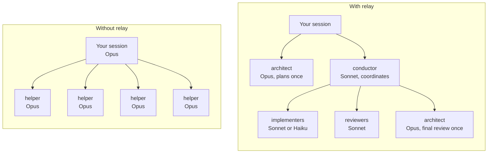

## How relay works, in one picture


Opus plans the work and reviews the finished branch. Between those two points it only touches the tasks the plan marks as hard and fixes that cheaper models could not finish. Everything else runs on Sonnet or Haiku, and because the expensive judgment calls were already made in the plan, the cheaper models mostly carry out decisions.

## Core ideas

### 1. A model for every task

Relay has three tiers. Each agent role belongs to one, and every task in a plan gets one.

| Tier | Claude Code | Codex | Who uses it |
|---|---|---|---|
| **cheap** | Haiku, low effort | gpt-6-luna, low | `scout` (finds code), `implementer-fast` (types out code the plan already contains) |
| **mid** | Sonnet, medium effort | gpt-6.1-sol, medium | `implementer`, `test-author`, `reviewer`, `conductor`, and any helper started without a model |
| **strong** | Opus, high effort | gpt-6-astra, high | `architect` (plan and final review), `implementer-deep` (hard tasks and escalations) |

The architect picks a task's tier while planning, with simple rules:

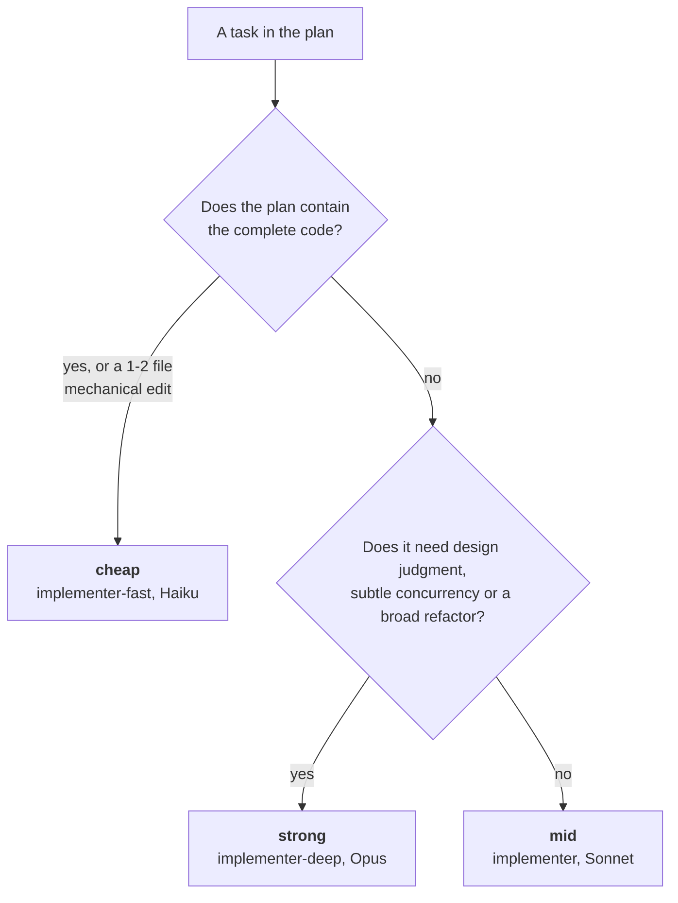

When in doubt the answer is mid. Cheap models often need two or three times as many turns on instructions written in prose, which can cost more than running Sonnet once.

In Claude Code, relay's **mod** (a small module that hooks into Claude Code itself) enforces the routing, so it does not depend on the model remembering a rule:

- a built-in helper started without a model (`general-purpose`, `Plan`) gets Sonnet, and `Explore` gets Haiku, where they would otherwise inherit Opus;
- when the usage budget is tight, any helper headed for Opus is moved to Sonnet, except the architect;
- when the budget is critical, new implementers are refused with a message telling the coordinator to wrap up.

### 2. Plans that carry the decisions

Everything that needs judgment is decided once, at plan time, by the strongest model. A plan is a markdown file for people plus one JSON block for tools:

````markdown
### T2: CSV writer
`writeCsv(rows: ExportRow[]): string` in `src/export/csv.ts`. Header `id,amount,currency`;
amount as `12.34` (two decimals, dot); RFC 4180 quoting.

```relay-plan
{
  "slug": "billing-export",
  "suite": "pnpm test",
  "setup": "pnpm install --frozen-lockfile",
  "tasks": [
    { "id": "T2", "title": "CSV writer", "tier": "mid", "risk": "medium",
      "files": ["src/export/csv.ts", "src/export/csv.test.ts"], "deps": ["T1"],
      "behaviors": ["amounts render with two decimals", "fields with commas or quotes are quoted"],
      "tests": 2,
      "done": "pnpm vitest run src/export/csv.test.ts" }
  ]
}
```
````

Each field has a job:

| Field | What it decides |
|---|---|
| `tier` | Which model builds the task. |
| `risk` | How much testing and review it gets (`low`, `medium`, `high`). |
| `files` | Every path the task touches. Relay groups tasks into lanes from this, so a missing file means a merge conflict later. |
| `deps` | Which tasks must land first. |
| `behaviors` and `tests` | What the task changes, seen from outside, and how many new tests that is worth. |
| `done` | The narrowest command that proves the task works. Never the whole suite. |

`relay lanes <plan>` checks the plan before anything runs: missing fields, unknown dependencies, cycles, a cheap tier on a multi-file prose task, a high-risk task with no test, a low-risk task with three. The full template is in [skills/plan-with-tiers/template.md](skills/plan-with-tiers/template.md).

### 3. Lanes and waves

A **lane** is a group of tasks that touch the same files. A lane gets one git worktree and one implementer, who does its tasks in order with one commit per task. Because the agent stays in the same context, it reads the module once and keeps working, and its prompt cache stays warm.

A **wave** is a set of lanes that can run at the same time. Lanes in a wave share no files, so they never conflict. When a lane depends on another lane's work, it waits for the next wave.

Relay computes this from the plan, with no model involved:

1. Tasks that share a file go in the same lane.
2. A chain of dependent tasks folds into one lane, while it stays small (6 tasks by default), so there is no merge between steps.
3. Waves follow the remaining dependencies between lanes.
4. A wave with too many lanes (4 by default) packs its smallest lanes together.

Here is the example plan from this repository's tests, six tasks for a billing export:

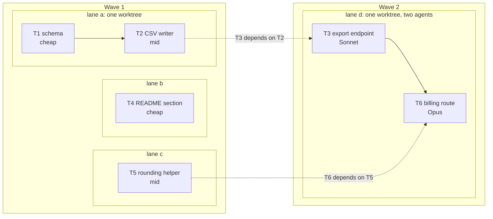

T3 and T6 both edit `src/routes/index.ts`, so they share lane d. They depend on work from lanes a and c, so lane d runs in wave 2. T6 is the one hard task in the plan, so lane d is split: a Sonnet agent does T3, then an Opus agent does T6 in the same worktree. The routine task never runs on the expensive model.

This is what relay prints for that plan:

```text
$ relay lanes docs/relay/plans/2026-10-19-billing-export.md
plan billing-export: 6 tasks → 4 lanes in 2 wave(s)
wave 1
  lane a  [risk medium, new tests ≤ 2]  lane-a=implementer(T1 → T2)
  lane b  [risk low, new tests ≤ 0]  lane-b=implementer-fast(T4)
  lane c  [risk medium, new tests ≤ 1]  lane-c=implementer(T5)
wave 2
  lane d  [risk high, new tests ≤ 3]  lane-d=implementer(T3), then lane-d-s2=implementer-deep(T6)
```

#### Worktrees are reused

Relay keeps a small pool of worktrees per plan. They are created once and dependencies are installed once. Between waves, each worktree is moved to the newly merged code; nobody creates a fresh checkout.

```text
your-repo/                              your checkout, untouched during a run
├── .claude/worktrees/
│   ├── relay-billing-export-int        integration branch; the full suite runs here
│   ├── relay-billing-export-1          slot 1: lane a, then lane d in wave 2
│   ├── relay-billing-export-2          slot 2: lane b
│   └── relay-billing-export-3          slot 3: lane c
└── .relay/runs/billing-export/         briefs, reports, review packages, the ledger
```

The branches end up like this:

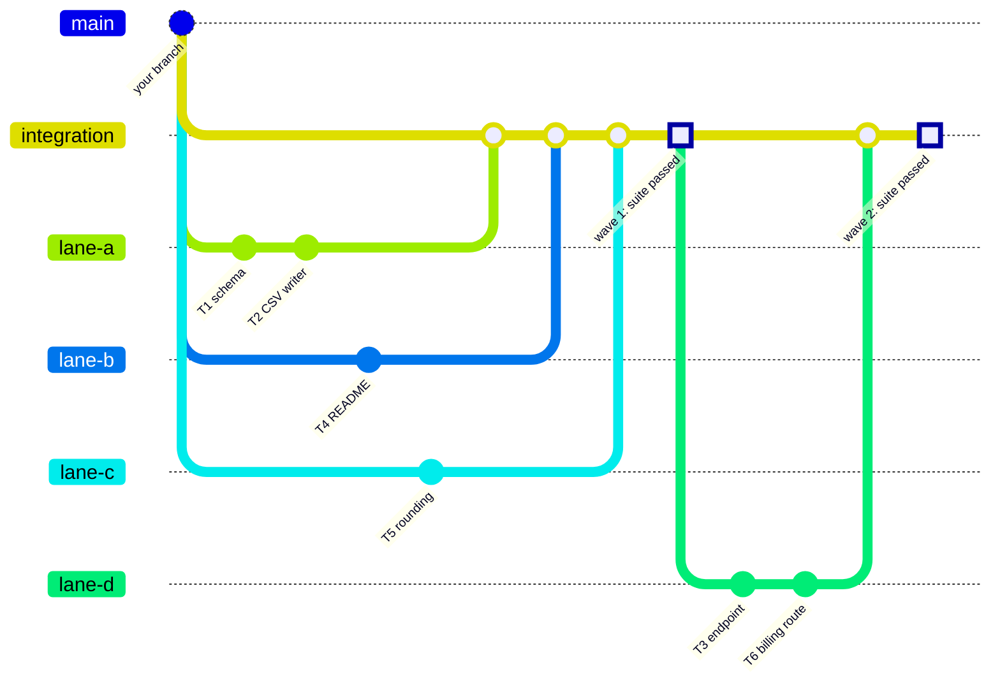

The real branch names are `relay/<slug>/integration` and `relay/<slug>/lane-<id>`. Your own branch is never touched; merging the integration branch into it is your call.

In Claude Code, an agent started with the name `lane-a` is placed in lane a's worktree by relay's mod. In Codex, the dispatch tells the agent which directory to work in.

### 4. Reviews and the fix loop

Every lane is reviewed once, task by task, against the plan and the spec. The reviewer gets a single file with the lane's commits and full diff (`relay worktrees pack`), so it does not spend turns rebuilding the diff with git commands.

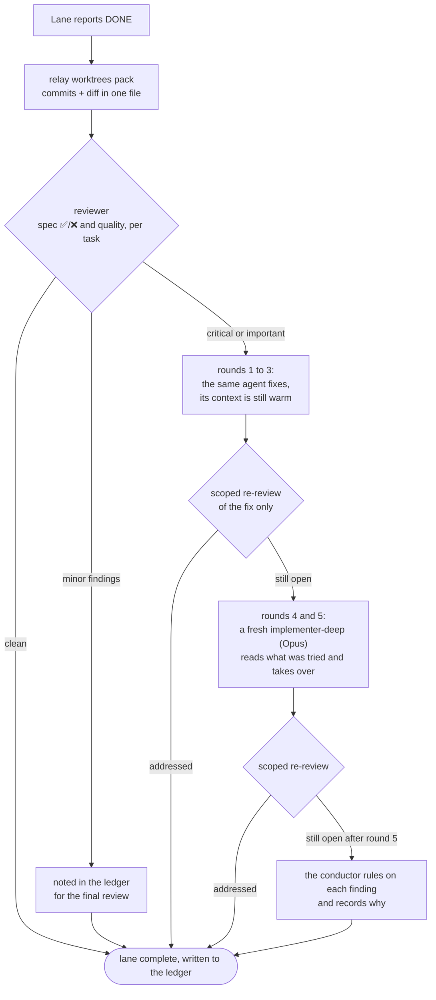

Three rules keep this loop from eating the budget:

- Re-reviews only look at the fix, so they cannot wander into new topics.
- Minor findings never enter the loop. They are written down for the final review to triage.
- After five rounds the loop stops. A loop that has not converged by then is a problem in the plan, and more rounds will not fix it.

Every decision the conductor makes on your behalf is written to the ledger as `Ruling: what — why — what it costs if wrong`, and the final report lists all of them.

### 5. The usage budget

Relay's mod reads the same 5-hour and weekly figures Claude Code shows you in `/usage`, and writes them to `~/.relay/budget.json` so that `relay budget` and the skills can read them.

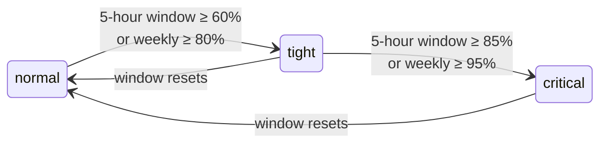

| Level | What changes |
|---|---|
| **normal** | Every task runs on its planned tier. |
| **tight** | Opus is kept for the final review. Anything else headed for Opus runs on Sonnet. The conductor prefers cheap tiers where the plan holds complete code, and can send reviews to Codex. |
| **critical** | No new implementation starts. Lanes already running finish their tasks and fix rounds, the wave merges, and the conductor writes a handoff note. Claude Code can wait for the reset and pick up from there. |
| **unknown** | No reading yet (a fresh session, or Codex). Relay behaves as if the budget were tight. |

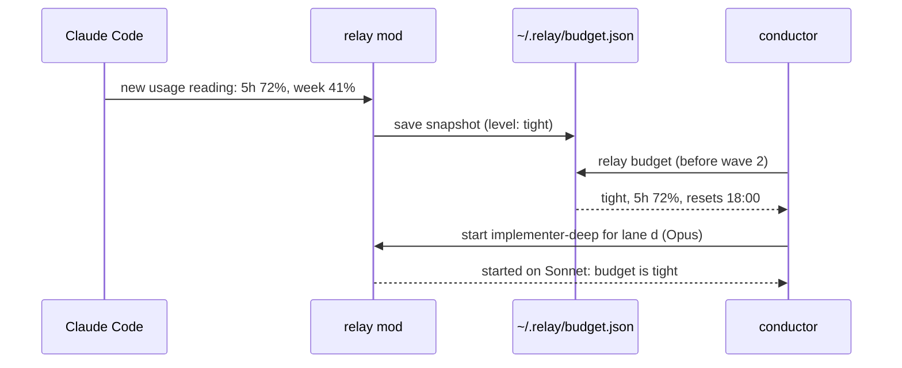

In your own session, relay also adds one line to your next prompt whenever the level changes, so the model you talk to knows where the budget stands.

The thresholds are starting points. Watch `/usage` for a week of real work and adjust them in `config/routing.json`.

### 6. Testing like QA

Coding agents tend to over-test. In recent studies, most tests written by agents had weak assertions or none, and re-running tests on unchanged code was one of the most common wastes in agent sessions. In one small experiment, making an agent write a failing test before every change cost three to eight times more tokens with no measurable gain in quality. [docs/design.md](docs/design.md#4-testing-evidence) has the sources.

Relay treats tests the way a QA engineer would: each test has to be able to catch a real bug that nothing else catches.

**A test budget per task, from its risk:**

| Risk | Examples | New tests |
|---|---|---|
| low | internal refactor, docs, config | 0 or 1. Types and existing tests usually cover it. |
| medium | user-visible behavior | One per behavior listed in the plan. |
| high | money, data loss, security, concurrency, migrations | One per behavior, plus boundary values and error cases, or one property-based test. Mutation testing on the changed lines. |

**Tests come from the spec, written by someone else.** For medium and high-risk lanes, a `test-author` agent writes the acceptance tests from the spec before the code exists. Tests written after reading the code tend to copy its bugs. Relay then protects those files: the implementer cannot edit, skip or weaken them.

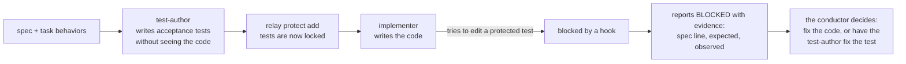

**Verification goes from narrow to wide, and only the last step is the full suite:**

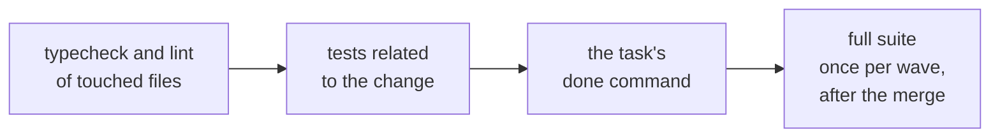

**The same test never runs twice on the same code.** A hook fingerprints the test command together with the exact state of the code. If nothing changed since the last run, the result cannot change either, so the run is refused and the agent gets the previous output back:

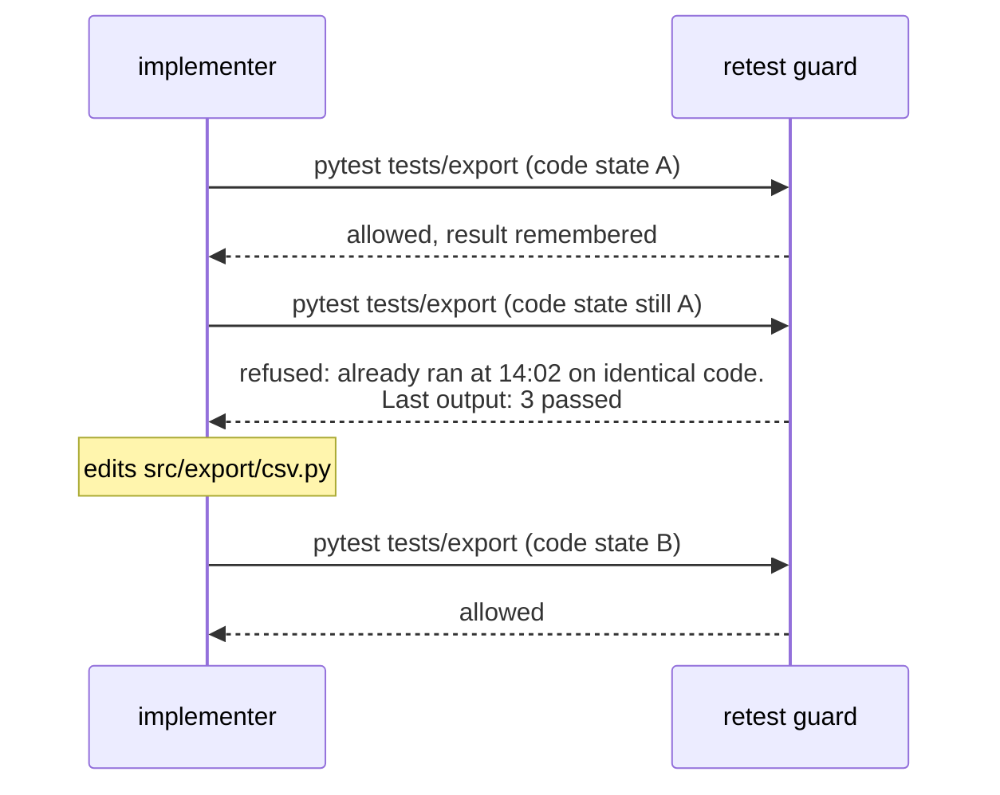

For a test that is really flaky, the agent can prefix the command with `RELAY_RERUN=1` and has to explain why in its report.

**Every report says what happened to the tests:** how many were added and removed, one line per new test naming the behavior it guards, and the commands that ran with their results. Reviewers delete tests that only mirror the code, assert nothing, or duplicate another test.

The full rules are in [skills/qa-mindset/SKILL.md](skills/qa-mindset/SKILL.md).

### 7. Claude Code and Codex together

Relay keeps one source for both tools. Skills are shared word for word, and agents and hooks are generated for each tool from `roles/` and `config/routing.json`.

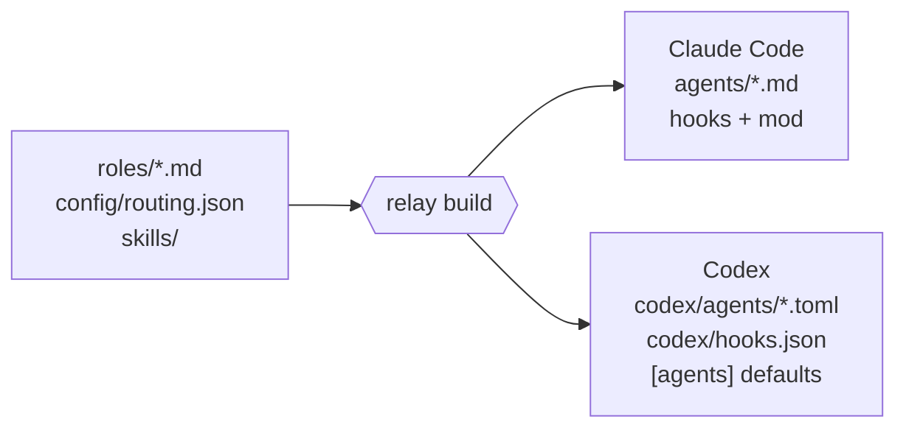

Claude and Codex have separate usage windows, so you can split the work between them. A common split: Claude plans and builds, Codex reviews read-only. A second model family also has different blind spots than the first, which makes it a better reviewer of the first one's code.

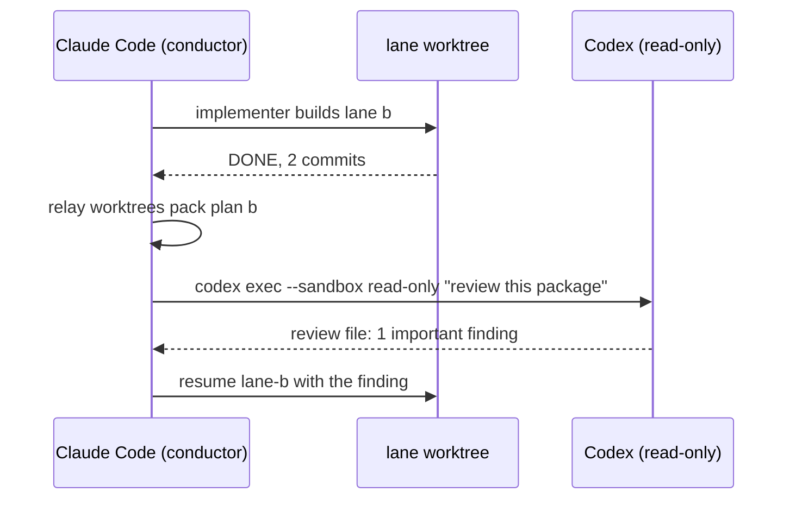

## Workflows, step by step

The examples below show what you type and what relay does. Agent output is shortened.

### Workflow 1: a new feature, end to end

**1. Describe the feature.** Point relay at a spec, or describe the feature and agree on it first.

> Plan the billing export in docs/specs/billing-export.md with relay.

**2. The architect writes the plan** (on Opus) to `docs/relay/plans/2026-10-19-billing-export.md`, runs `relay lanes` on it, fixes anything it reports, and shows you the lanes and waves:

```text
plan billing-export: 6 tasks → 4 lanes in 2 wave(s)
wave 1
  lane a  [risk medium, new tests ≤ 2]  lane-a=implementer(T1 → T2)
  lane b  [risk low, new tests ≤ 0]  lane-b=implementer-fast(T4)
  lane c  [risk medium, new tests ≤ 1]  lane-c=implementer(T5)
wave 2
  lane d  [risk high, new tests ≤ 3]  lane-d=implementer(T3), then lane-d-s2=implementer-deep(T6)
```

Read the plan. This is the cheapest moment to change your mind.

**3. Say go.**

> Run the plan.

The conductor (Sonnet) takes over and works without stopping to check in:

```text
relay budget                         → budget: normal — 5h 18%, 7d 22%
relay worktrees sync <plan> --wave 1 → 3 worktrees created, briefs written
test-author for lane a (risk medium) → 2 acceptance tests, protected
lane-a, lane-b, lane-c dispatched in parallel
lane-b DONE → reviewer: clean
lane-c DONE → reviewer: 1 important finding → fix round 1 → addressed
lane-a DONE → reviewer: clean
relay worktrees merge <plan> --wave 1 --suite → 4 commits merged, suite passed
relay worktrees sync <plan> --wave 2 → slot 1 reused for lane d
lane-d (Sonnet: T3) DONE → lane-d-s2 (Opus: T6) DONE → reviewer: clean
relay worktrees merge <plan> --wave 2 --suite → suite passed
architect: final review of the whole branch → 1 deferred minor to fix before merge
```

**4. Read the report.** You get the branch `relay/billing-export/integration`, the waves and lanes with their status, how many tests were added and removed, and every ruling the conductor made, each with its reason and what it costs if it was wrong. Review the branch like any pull request and merge it when you are happy.

### Workflow 2: a small change, no plan

Not everything needs lanes. For a bug fix or a one-file change, keep talking to your agent as usual:

> The invoice total is off by a cent when a line has three decimals. Fix it.

Relay still shapes the work:

- If the agent sends a helper to look around, the helper runs on Haiku (`Explore`) or Sonnet, not Opus.
- The `qa-mindset` skill asks for one regression test that reproduces the bug, with the expected value taken from the bug report, never from running the code.
- Verification stays narrow: the related test file, then the typecheck. The retest guard stops the agent from re-running the suite "to be sure".

### Workflow 3: the budget runs low mid-run

You are halfway through a large plan and the 5-hour window reaches 86%.

1. The mod marks the budget **critical**. The conductor sees it when it checks `relay budget` after a lane finishes, and any new implementer it tries to start is refused with the same message.
2. Lanes already working finish their current tasks and fix rounds; nothing new starts.
3. The conductor merges what is done, then writes `.relay/runs/<slug>/HANDOFF.md`: the goal, the branch and its last commit, what is finished and verified, what is in flight, the next three steps, and every ruling so far.
4. When the window resets, start a fresh session and say:

> Read .relay/runs/billing-export/HANDOFF.md and continue from "Next".

The ledger and the lane branches are on disk, so nothing depends on the old conversation. Lanes that already finished are never dispatched again.

### Workflow 4: a protected test looks wrong

The implementer of lane a cannot make the acceptance test for "amounts render with two decimals" pass. The test expects `12.3`, the spec says `12.30`.

1. The implementer tries to change the test. The protect hook refuses the edit.
2. It reports `BLOCKED` with the evidence: the spec line, what the test expects, what the code produces.
3. The conductor compares that against the spec, rules that the test is wrong, and records the ruling.
4. It runs `relay protect remove` for that file, has the test-author fix it, protects it again, and resumes the implementer.

The implementer never decides on its own that a test is wrong, and the decision ends up in the final report.

### Workflow 5: Claude builds, Codex reviews

With Codex installed, the conductor sends reviews of high-risk lanes to Codex, and all reviews once the budget is tight:

```bash
codex exec --sandbox read-only -o .relay/runs/billing-export/lane-d.codex-review.md \
  "Review per roles/reviewer.md: brief <path>, report <path>, package <path>"
```

The review lands in a file, the conductor reads its verdicts, and the fix loop continues as usual. The review is paid from your Codex window.

### Workflow 6: running relay inside Codex

The same skills work in Codex. Invoke them by name, for example `$plan-with-tiers` and `$run-lanes`, or just describe what you want. The conductor spawns `relay-implementer`, `relay-reviewer` and the other agents installed by `relay setup codex`, always naming the model and reasoning effort. Each lane's dispatch starts with the absolute path of its worktree.

## Installation

Relay needs **git** and **Node 20 or newer**.

### Claude Code

```text
/plugin marketplace add cube-digital/relay
/plugin install relay@relay
```

Then, inside each repository where you want to use lanes:

```bash
relay setup claude --write-project
```

This adds two settings to `.claude/settings.json` that a plugin cannot set for itself:

- `worktree.baseRef: "head"`, so lane worktrees branch from your current branch (by default they would start from `origin`'s main branch);
- `subagentPromptCacheTtl: "1h"`, so a lane keeps its prompt cache while it waits for a review (the default is five minutes).

To check the install, run `/plugin` and look for `1 mod active · relay`, then run `relay budget` after your first message in a session. The mod needs a recent Claude Code; relay is tested on 2.1.303. Without the mod, the skills, agents and hooks still work, only without automatic routing and budget readings.

### Codex

```bash
codex plugin marketplace add cube-digital/relay        # the skills
git clone https://github.com/cube-digital/relay ~/relay
cd ~/relay && npm link                                  # puts `relay` on your PATH
relay setup codex /path/to/your/project                 # agents, hooks, model defaults
```

`relay setup codex` writes three things into the project's `.codex/` folder: one agent file per role with its model and reasoning effort, a `hooks.json` with relay's hooks, and an `[agents]` default so a helper started without a model never inherits the most expensive one. Open Codex in the project and trust the hooks with `/hooks`.

## What's inside

### Skills

| Skill | Used when |
|---|---|
| `using-relay` | At the start of every session. Loaded automatically; sets the rules below in about 2 KB. |
| `plan-with-tiers` | Turning a spec into a plan with tiers, risk, files, test budgets and done checks. |
| `run-lanes` | Executing a plan: waves, lanes, reviews, fix loops, merges, the final review. |
| `qa-mindset` | Writing, running or reviewing tests. |
| `handoff` | The budget turns critical, the context gets long, or work moves to a new session. |
| `relay-setup` | Installing relay or checking why routing or lanes misbehave. |

### Agents

| Agent | Tier | Job |
|---|---|---|
| `scout` | cheap | Finds files, symbols and call sites. Returns paths and line numbers, never whole files. |
| `implementer-fast` | cheap | Transcribes code the plan already contains. Stops when the plan is unclear. |
| `implementer` | mid | Builds a lane task by task in its worktree, one commit per task. |
| `implementer-deep` | strong | Hard tasks, and fix rounds 4 and 5 when others got stuck. |
| `test-author` | mid | Writes acceptance tests from the spec without reading the implementation. |
| `reviewer` | mid | Read-only. Reviews a lane per task against the spec, and audits its tests. |
| `architect` | strong | Writes the plan and does the final review of the branch. |
| `conductor` | mid | Runs a whole plan, so coordination happens on Sonnet. |

Every worker writes its full report to a file and returns at most eight lines: a status (`DONE`, `DONE_WITH_CONCERNS`, `NEEDS_CONTEXT` or `BLOCKED`), its commits, its test counts, the report path and any concern. The conductor's context stays small however long the run.

### Hooks and the mod

| Piece | Runs in | What it does |
|---|---|---|
| `session-start` | Claude Code, Codex | Loads the `using-relay` rules and the current budget level into every new session. |
| `retest-guard` | Claude Code, Codex | Refuses a test command on code that has not changed since its last run. |
| `protect-tests` | Claude Code, Codex | Refuses edits, from editors or the shell, to protected acceptance tests. |
| mod (`hooks/register.ts`) | Claude Code | Model routing, budget readings, budget caps, and putting `lane-*` agents into their worktrees. |

All hooks fail open: if one crashes, the tool call goes ahead as if relay were not installed.

### The `relay` command

```text
relay lanes <plan> [--write]                  validate a plan, show lanes and waves, write briefs
relay worktrees sync <plan> --wave N          create or reuse lane worktrees from the integration head
relay worktrees pack <plan> <lane> [--from]   review package for a lane, or for a fix
relay worktrees pack <plan> --final           package of the whole branch for the final review
relay worktrees merge <plan> --wave N --suite merge a wave, then run the full suite once
relay worktrees status | clean <plan>         what each lane is doing; remove the worktrees
relay ledger <plan> ["line"] [--rulings]      the run's memory on disk
relay protect add | remove | list <paths>     acceptance tests the implementers may not change
relay budget [--codex] [--json]               5-hour and weekly level: normal, tight, critical
relay build [--check]                         regenerate agents and hooks for both tools
relay setup claude | codex                    settings a plugin cannot set for itself
```

Mechanical work runs in this command and costs no tokens: checking plans, grouping lanes, managing worktrees, building review packages.

## Configuration

Everything about models and limits lives in [config/routing.json](config/routing.json):

```jsonc
{
  "tiers": {
    "cheap":  { "claude": { "model": "haiku",  "effort": "low" },    "codex": { "model": "gpt-6-luna",  "effort": "low" } },
    "mid":    { "claude": { "model": "sonnet", "effort": "medium" }, "codex": { "model": "gpt-6.1-sol", "effort": "medium" } },
    "strong": { "claude": { "model": "opus",   "effort": "high" },   "codex": { "model": "gpt-6-astra", "effort": "high" } }
  },
  "unrouted": { "general-purpose": "mid", "claude": "mid", "Plan": "mid", "Explore": "cheap" },
  "budget": {
    "fiveHour": { "tight": 60, "critical": 85 },
    "sevenDay": { "tight": 80, "critical": 95 },
    "tight":    { "capStrongTo": "mid", "exempt": ["architect"] },
    "critical": { "capStrongTo": "mid", "denyNewSpawns": ["implementer", "implementer-fast", "implementer-deep", "test-author"] }
  },
  "lanes": { "maxLaneTasks": 6, "maxParallelLanes": 4 }
}
```

To change which tier a role uses, edit its file in `roles/`. After any change, run `relay build`; it regenerates the agent files for both tools and the routing table inside the mod.

`maxParallelLanes` is limited more by your machine than by relay: each lane may run its own dev server, database or test ports. Four is a safe start.

## FAQ

**Do parallel agents save tokens?**
No. Anthropic measured multi-agent systems using about 15 times the tokens of a chat. Lanes save time. Tokens are saved by running most work on Sonnet and Haiku, keeping each agent's context small, and never doing the same work twice.

**Will relay change the model of my main session?**
No. Your session stays on the model you chose. Relay routes the helper agents, and it recommends keeping one model and effort for the whole session, because switching mid-session re-reads the whole conversation without the cache.

**Is the conductor required?**
No. The main session can run the `run-lanes` skill itself. The conductor exists so coordination runs on Sonnet when your session runs on Opus.

**What if relay has a bug?**
Its hooks fail open, and `/plugin` disables relay completely.

**Can I use it with superpowers?**
Yes, with one caveat. superpowers' test-driven development skill asks for a failing test before every change, and relay sets a test budget per task, so their testing advice disagrees. superpowers' brainstorming and debugging skills work well next to relay.

**Do I need Codex?**
No. Codex support is for teams that use both tools, or that want a second model family to review the first one's work.

**What does "the plan contains the complete code" mean?**
For a mechanical task, the architect can write the exact code into the plan. The task then becomes transcription plus a check, which Haiku does well. This is where the biggest savings come from, so the architect is asked to do it wherever it is practical.

## Status and roadmap

Version **0.1**. The `relay` command, the hooks and the Claude Code mod have automated tests: 34 for the command and hooks against real git repositories, and 8 for the mod inside Claude Code's own test kit. The plugin passes `claude plugin validate`.

Still to confirm on a real install:

- [ ] An agent started as `lane-a` lands in its lane's worktree and stays there when resumed. [spikes/worktree-lanes.md](spikes/worktree-lanes.md) walks through the check in about 30 minutes.
- [ ] Codex accepts the generated hooks file as written.
- [ ] The Codex model names in `config/routing.json` match the current ones (they change often).
- [ ] `relay budget --codex` reads Codex's usage window; it relies on an undocumented file.

Next:

- a budget bar above the prompt in Claude Code;
- reading the Codex budget through a documented interface;
- diff-scoped mutation testing as one `relay` command;
- cost measurements on real plans, with and without relay.

Issues and pull requests are welcome.

## Contributing

```bash
npm test                          # unit and integration tests, against real git repositories
node bin/relay build --check      # generated files are in sync, skills are portable
claude plugin validate . && claude plugin test .
```

Edit `roles/` and `config/routing.json`, then run `relay build`. The files in `agents/` and `codex/` are generated. [AGENTS.md](AGENTS.md) has the rules for agents working on relay itself, and [docs/design.md](docs/design.md) the research and sources behind each decision.

## Credits

Relay borrows its best mechanics from [superpowers](https://github.com/obra/superpowers): plans as the single source of decisions, a ledger on disk that survives compaction, the worker status protocol, review packages, and bounded fix loops with escalation.

## License

Apache 2.0. See [LICENSE](LICENSE).
