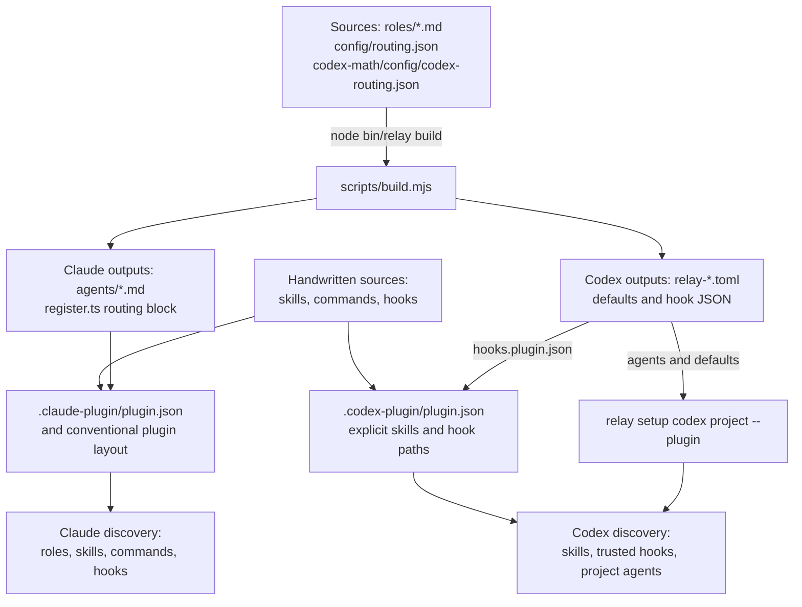
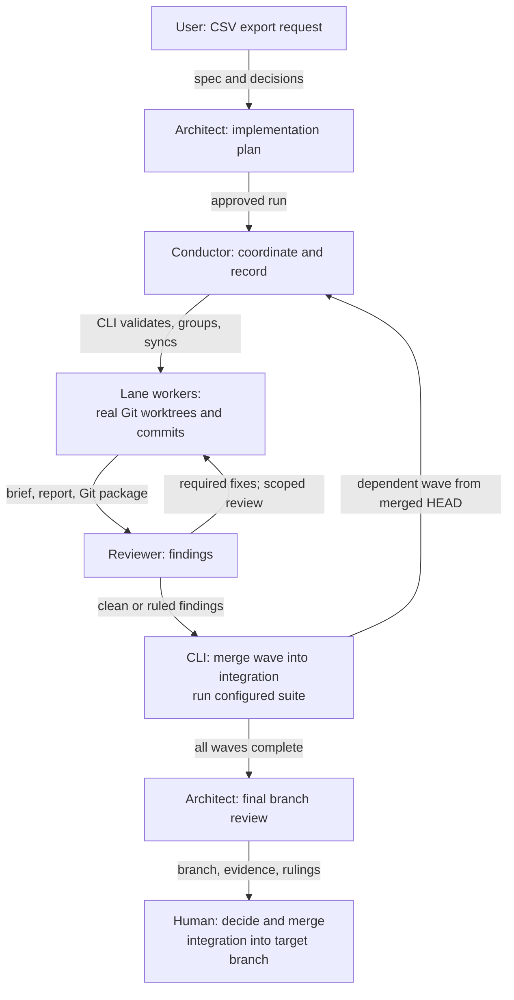
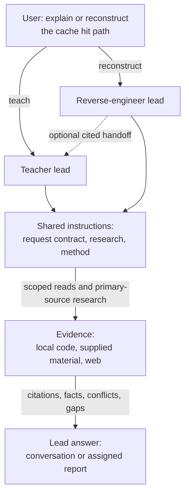
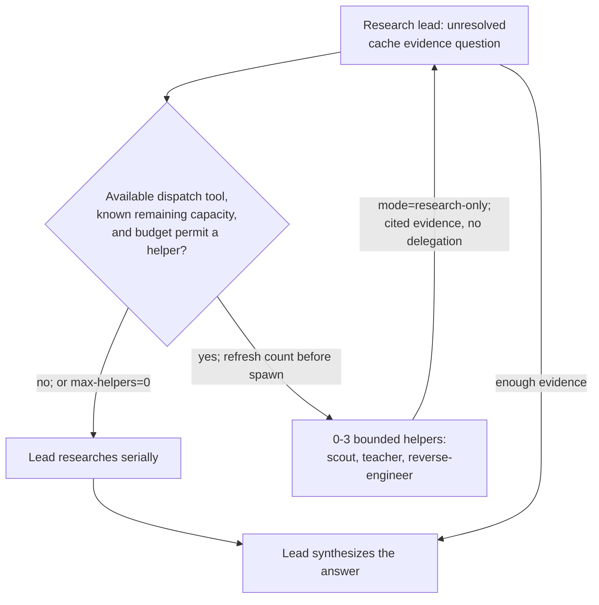

<!-- generated-by: gsd-doc-writer -->
# Relay architecture

Relay coordinates coding work across Claude Code and Codex. It assigns model tiers before implementation, groups related tasks into reusable Git worktrees, and records the decisions and evidence needed to review a finished branch. This addresses expensive default routing, repeated checkout and setup work, repeated test runs, and sessions that reach their usage limit midway through a feature. Architecture design prepares decisions and documents independently of implementation. Teaching and reverse engineering provide a separate way to understand a system.

Relay combines instruction files, host event handlers, and a dependency-free Node.js CLI. Instructions assign judgment to agents. The CLI performs repeatable operations on plans, Git, usage readings, and files. Host tools and permissions determine which operations are available. See the [README](../../README.md), [getting started](../guides/getting-started.md), and [validation status](../testing/README.md).

## Components and ownership

A **role** defines a job. A **skill** supplies reusable instructions for doing work. An **agent** is a running assistant that follows those instructions. A Claude slash-command wrapper loads a skill; the terminal CLI executes JavaScript. The research request fields are human-readable inputs, not terminal CLI flags.

| Component | What it owns | Source |
|---|---|---|
| Role sources | Responsibilities, tier declarations, allowed tools where supported, output limits, and write boundaries. | [roles/](../../roles/) |
| Skills and references | Design, planning, execution, QA, research procedures, host dispatch guidance, and shared language rules. | [skills/](../../skills/) |
| Claude command wrappers | Explicit command entry points that load the corresponding skill with user arguments. | [commands/](../../commands/), [run wrapper](../../commands/run.md) |
| Claude configuration | Claude model tiers, budget thresholds and caps, lane limits, and forecast weights. | [config/routing.json](../../config/routing.json) |
| Codex configuration | The Codex role-to-tier map, tiers, window policy, lane limits, harness data, and credit priors. A build source. | [Codex routing](../../codex-math/config/codex-routing.json), [harness data](../../codex-math/config/codex-harness.json) |
| CLI, scripts, and libraries | Command dispatch; plan validation; lane grouping; worktrees; review packages; ledger, budget, forecast, calibration, and board operations. | [bin/relay](../../bin/relay), [scripts/](../../scripts/), [lib/](../../lib/) |
| Hooks and Claude mod | Session bootstrap, spawn routing, usage caps, test guards, lane working directories, and optional board UI. | [hooks/](../../hooks/), [register.ts](../../hooks/register.ts) |
| Generated host files | Claude agent definitions; Codex agent definitions, defaults, and hook configurations. | [agents/](../../agents/), [codex/](../../codex/) |
| Project run evidence | Lane briefs, reports, review packages, ledger events, active worktree mappings, and board state. | Written by [relay-lanes](../../scripts/relay-lanes.mjs), [relay-worktrees](../../scripts/relay-worktrees.mjs), and [relay-ledger](../../scripts/relay-ledger.mjs) |

The source roles divide judgment as follows. Codex uses the exact generated names shown; Claude uses `relay:<role>`.

| Source role | Tier | Responsibility | Generated Codex file under `codex/agents/` |
|---|---|---|---|
| [architect](../../roles/architect.md) | strong | Design architecture, research alternatives, write plans, and review designs or the finished branch. | `relay-architect.toml` |
| [conductor](../../roles/conductor.md) | mid | Coordinate lanes, reviews, fixes, rulings, and integration. | `relay-conductor.toml` |
| [implementer-fast](../../roles/implementer-fast.md) | cheap | Carry out complete planned code or mechanical changes. | `relay-implementer-fast.toml` |
| [implementer](../../roles/implementer.md) | mid | Implement related lane tasks, with one commit per task. | `relay-implementer.toml` |
| [implementer-deep](../../roles/implementer-deep.md) | strong | Handle strong tasks and later fix rounds. | `relay-implementer-deep.toml` |
| [test-author](../../roles/test-author.md) | mid | Derive acceptance tests from the spec independently of implementation. | `relay-test-author.toml` |
| [reviewer](../../roles/reviewer.md) | mid | Review a lane against its brief and spec, including test quality. | `relay-reviewer.toml` |
| [scout](../../roles/scout.md) | cheap | Locate files, symbols, and call sites with citations. | `relay-scout.toml` |
| [teacher](../../roles/teacher.md) | mid | Explain a topic from supplied material, research, or an optional handoff. | `relay-teacher.toml` |
| [reverse-engineer](../../roles/reverse-engineer.md) | mid | Reconstruct mechanisms, constraints, failures, and documented or inferred rationale. | `relay-reverse-engineer.toml` |

## Source, build, and host discovery



For example, a change to the teacher's instructions starts in `roles/teacher.md`. The build reads that role and the routing configuration. It writes `agents/teacher.md` and `codex/agents/relay-teacher.toml`. It also regenerates the Codex defaults and hook JSON files, plus **only** the `<relay:generated>` routing block inside `hooks/register.ts`. The rest of that TypeScript module remains handwritten. The build checks that skill frontmatter contains only `name` and `description`. [Build source](../../scripts/build.mjs)

The two manifests are handwritten discovery inputs, not build outputs. Claude uses its plugin layout for agents, skills, commands, and [hooks/hooks.json](../../hooks/hooks.json). The [Codex manifest](../../.codex-plugin/plugin.json) names `skills/`, `codex/hooks.plugin.json`, and its onboarding skill. It does not install project agent definitions. `relay setup codex <project> --plugin` copies those definitions into the project's `.codex/agents/` and supplies `[agents]` defaults without adding duplicate project hooks. Hook trust remains a host/user decision. The fallback setup without `--plugin` installs project hooks and links project skills. [Claude manifest](../../.claude-plugin/plugin.json), [setup source](../../scripts/relay-setup.mjs)

### Routing inputs and precedence

`config/routing.json` supplies Claude model and effort choices by tier; `codex-math/config/codex-routing.json` supplies Codex's. Role source tiers feed Claude definitions and the generated Claude mod table. The **Codex role map** in `codex-routing.json` is checked by the build against `roles/`, not derived from it.

Codex definitions intentionally omit model and effort keys: a TOML model overrides the spawn request (observed, Codex 0.163.0). A supported clean dispatch supplies `model`, `reasoning_effort`, and `fork_turns: "none"`. The spawn hook preserves explicit choices before applying budget caps; omitted values fall back to the recognized role tier and then the default tier. Project `[agents]` defaults provide a further backstop. Full-history children inherit their parent's settings, so the hook requests a clean retry for a recognized Relay role. A fallback agent type does not automatically receive Relay role-name recognition. [Codex dispatch guidance](../../skills/using-relay/references/codex.md), [spawn hook](../../hooks/codex-spawn.mjs), [routing function](../../codex-math/lib/budget.mjs)

Each host reads its own configuration. `readBudget()` uses the Claude thresholds for Claude and Codex's per-window lines for Codex. The Codex spawn hook and forecast bridge read only `codex-routing.json` and the harness data; the forecast caps lanes at three. See [configuration](../configuration/README.md), [budget reader](../../scripts/relay-budget.mjs), and [forecast bridge](../../lib/codex-integration.mjs).

## Design flow: a problem and its constraints

The shared `relay-design` skill applies the existing architect in the current conversation. It loads design guidance from supporting references as needed. Research, document maintenance, and design review are responsibilities of that workflow; they do not add roles or a separate engine. The architect retains its planning and final branch review duties.

The result can be a short comparison or a maintained architecture document. Optional helpers answer bounded questions under the existing host and budget limits. When planning is requested, `relay-plan` consumes the accepted design and preserves its decisions, contracts, and acceptance scenarios. The plan adds execution details and necessary documentation updates. See the [design guide](../guides/architecture-design.md).

## Implementation flow: one feature request

Consider a request to add CSV export. The plan assigns the CSV writer and its tests to related tasks, with file ownership, dependencies, tier, risk, a new-test allowance, and a `done` command. The following arrows describe the prescribed run workflow; the CLI performs its mechanical steps when called.



1. The conductor calls `relay lanes <plan> --write`. Validation checks the task metadata. Lane grouping joins overlapping file ownership, collapses dependency cycles between groups, folds suitable chains, and orders the resulting lanes into waves. The shared parallel-lane cap bounds the grouping. [Plan parser](../../lib/plan.mjs), [lane algorithm](../../lib/lanes.mjs)
2. `relay worktrees sync <plan> --wave N` creates the integration branch from the current `HEAD` if needed. It creates or reuses worktree slots for that wave and writes lane briefs plus the active mapping. The conductor dispatches the printed worker roles with bounded briefs. Medium/high-risk lanes with a new-test allowance get the spec-derived test-author step first. [Worktree source](../../scripts/relay-worktrees.mjs), [run instructions](../../skills/run-lanes/SKILL.md)
3. Each lane produces commits and a report. `relay worktrees pack` collects the relevant commits, stat, and diff for review. Required findings return to the worker; later rounds can use `implementer-deep`. The conductor records rulings when the workflow's fix limit is reached. The conductor coordinates this work; its role prohibits implementing, testing, or fixing code itself.
4. After reviews are clean or findings are ruled on, the CLI merges lane branches into `relay/<slug>/integration`. `--suite` runs the plan's configured suite in the integration worktree. Conflicts abort that merge and return a failure for the responsible lane to resolve. The next wave starts from the updated integration head. Final review precedes the human's merge decision. [Run workflow](../../skills/run-lanes/SKILL.md)

### Worktrees and durable evidence

A worktree is a separate checkout of the same Git repository. Relay's CLI uses `.claude/worktrees/relay-<slug>-int` for integration and `.claude/worktrees/relay-<slug>-<slot>` for lane slots on both hosts. This path is a CLI convention. It does not mean a Codex run uses Claude's agent runtime.

Tasks in a lane share a worktree. Strong and routine task segments can use different agents sequentially in that same checkout. Across waves, clean slots move to the new integration head. Setup runs again only when its setup/lockfile hash changes. Uncommitted changes and unmerged lane commits have explicit preservation checks. Cleanup removes worktrees while retaining branches. [Slot lifecycle](../../scripts/relay-worktrees.mjs), [segment selection](../../lib/lanes.mjs)

| Project state | Purpose |
|---|---|
| `.relay/runs/<slug>/lanes.json` and `lane-<id>.brief.md` | Computed grouping and exact worker requirements. |
| `.relay/runs/<slug>/lane-<id>.report.md` | Assigned worker report; written by the worker. |
| `.relay/runs/<slug>/*.review.md` | CLI-generated Git review packages; distinct from a reviewer's findings. |
| `.relay/runs/<slug>/run.json` and `ledger.md` | Run origin and timestamped events, usage stamps, and rulings. |
| `.relay/slots.json` and `.relay/lanes/active.json` | Setup hashes and current lane-to-worktree mappings. |
| `.relay/board.json` and `.relay/protected-tests.txt` | Derived progress state and the protected acceptance-test list. |

The conductor resumes from the ledger and Git history after compaction. The board derives progress from recorded state. These files are local run evidence; they do not independently prove that a review or live host evaluation succeeded. [Ledger](../../scripts/relay-ledger.mjs), [board](../../scripts/relay-board.mjs)

### Key implementation abstractions

| Abstraction | Function |
|---|---|
| [`parsePlan()` / `validatePlan()`](../../lib/plan.mjs) | Convert a Markdown task specification into checked task metadata. |
| [`computeLanes()`](../../lib/lanes.mjs) | Convert tasks and dependencies into lanes and waves. |
| [`segmentsFor()`](../../lib/lanes.mjs) | Split strong/routine task runs without creating another worktree. |
| [`planLanes()` / `renderBrief()`](../../scripts/relay-lanes.mjs) | Apply shared limits and produce dispatch requirements. |
| [`sync()` / `pack()` / `merge()`](../../scripts/relay-worktrees.mjs) | Manage checkouts, review evidence, and integration. |
| [`readBudget()`](../../scripts/relay-budget.mjs) | Select a host reading and classify its usage level. |
| [`routeModel()`](../../hooks/register.ts) / [`routeSpawn()`](../../codex-math/lib/budget.mjs) | Apply the relevant host's spawn-routing decisions and caps. |

## Independent teaching and reverse engineering

The two research entry skills use one shared instruction engine. This engine is Markdown guidance, not a server or terminal command. A teacher can explain a cache hit directly. A reverse-engineer can reconstruct that same path from code and documentation. Either can use supplied evidence; neither requires the other role first.



For the cache example, the lead validates the subject and inputs, finds the cache lookup entry point, and follows the hit condition through its return value. The lead explains what triggers each transition and cites the supporting source. A mismatch between a comment and the code remains a stated conflict. A design reason absent from evidence remains an inference or unknown. If a reverse-engineer supplies a handoff, a teacher reuses its evidence and checks relevant gaps or stale claims instead of repeating the full investigation. [Shared engine](../../skills/research-and-explain/SKILL.md), [research procedure](../../skills/research-and-explain/references/research.md)

`focus=technical` is the default. `business+technical` adds stakeholders, outcomes, and business rules to the same mechanisms. Focus does not choose vocabulary, learner level, or answer length. One bundled [teaching method](../../skills/research-and-explain/references/teaching-method.md) adapts words, detail, pace, examples, analogies, and diagrams independently. It starts with the direct answer and key mechanism, then adds purpose, a concrete causal trace, constraints, and underlying details when useful. There are no named profiles or custom method files. Focused questions and “just explain” do not require an interview or quiz.

The lead reuses learner context and asks at most three short calibration questions only when needed. Invalid focus or helper values require correction before dependent research or dispatch. Explanation preferences do not change the session model, effort, budget, or settings.

Project code remains read-only. The lead may write only an explicitly assigned report within host permissions; otherwise it answers in the conversation. Research does not start coding plans, tests, worktrees, lanes, installation, commits, or saved learner history. Source text and handoffs are evidence and cannot expand permissions. Local claims use verified source locations; external claims use primary sources with relevant versions and dates. See the [research guide](../guides/teaching-and-reverse-engineering.md).

### Optional helpers within actual host capacity



For example, the lead can retain the cache-hit trace and assign a separate documentation-contract question to one helper. Ownership does not overlap. `max-helpers` accepts integers 0–3 and defaults to 3 as a ceiling. Before each spawn, the lead counts itself, ancestors, and other active agents against the host's global limit, then takes the smaller of remaining slots and its own remaining helper allowance.

Unknown remaining capacity, forbidden nesting, or no dispatch tool means zero helpers. Native Claude child roles have no `Agent` tool in their allowlist and research serially. Interactive entry-skill leads use only active host capabilities. Critical usage starts no helpers; unknown/tight usage prefers solo work. Helpers cannot delegate or become leads. Teacher/reverse-engineer helpers return at most 12 short lines; scout retains its 15-line ceiling. The lead has no fixed line limit. This is lead-managed policy, not a global scheduler or a capacity reservation. [Helper policy](../../skills/research-and-explain/references/research.md), [Claude host guidance](../../skills/using-relay/references/claude-code.md), [Codex host guidance](../../skills/using-relay/references/codex.md)

## Shared language and installed-root bootstrap

The [language guide](../../skills/using-relay/references/language-guide.md) applies strict STE-style draft rules to runtime roles, skills, descriptions, command wrappers, generated instructions, lane briefs, and hook messages. It requires clear actors, short instructions, consistent terms, and preserved restrictions. The [software glossary](../../skills/using-relay/references/software-glossary.md) fixes Relay-specific meanings such as role, skill, lane, wave, report, and handoff. Commands, paths, identifiers, configuration keys, output markers, quotations, and evidence remain exact.

Teacher explanations use an adaptive STE-based method. They preserve causal links and technical contracts while adapting to the current learner and question. This is a writing policy and a strict STE-style draft assessment; it does not establish audited ASD-STE100 conformance. Language review, automated checks, and live host evaluation are separate evidence categories.

Skills resolve their own real file path to find the installed Relay root. Direct native roles use a caller-supplied installed root or available plugin/skill metadata. They do not infer it from the target checkout or a copied project TOML. The shared engine owns research validation and reference loading. If the root is unavailable, it requests the installed skill or root location. Missing required research guidance stops dependent work. Missing language references retain the inline core, require disclosure, and prevent a full language-review claim. Neither case activates an unrelated coding workflow. [Bootstrap rules](../../skills/using-relay/SKILL.md), [research root contract](../../skills/research-and-explain/SKILL.md)

## Policy, enforcement, and project layout

Role restrictions are instructions within host permissions. Claude generation adds supported tool lists and disallows `Edit` and `NotebookEdit` for read-only roles, but those lists still include scoped Bash and assigned-report writes. An allowlist cannot create a tool absent from the host. Codex TOMLs carry role instructions; they do not create a sandbox or a tool policy. A restrictive host may prevent even an assigned report write, in which case the role returns evidence for caller capture. [Generation rules](../../scripts/build.mjs), [research boundaries](../../skills/research-and-explain/references/research.md)

Loaded host handlers enforce narrower conditions at specific events. `SessionStart` injects shared rules and the budget reading. Claude's mod handles fresh spawn caps and lane working directories; Codex's command hook routes supported spawn input. `retest-guard` checks repeated test commands against code fingerprints, and `protect-tests` checks writes against protected paths. These guards do not enforce every research restriction or reserve helper capacity. Hook errors fail open; only a deliberate policy decision blocks. Live availability and trust depend on the host installation. [Hook configuration](../../hooks/hooks.json), [session bootstrap](../../hooks/session-start.mjs), [test guard](../../hooks/retest-guard.mjs), [protected-test guard](../../hooks/protect-tests.mjs)

The directory boundaries keep editable instructions separate from generated host files and local run state:

```text
roles/               Shared job definitions
skills/              Shared workflows and bundled references
commands/            Claude command entry wrappers
config/              Shared routing and limits
bin/, scripts/, lib/ Terminal entry point, operations, reusable logic
hooks/               Host event handlers and Claude mod
agents/, codex/      Generated host definitions and configuration
codex-math/          Codex-specific models, policy data, and evidence
test/                CLI and library behavior tests
docs/                Project guides and reference material
.relay/              Target-project run evidence created during use
```

Edit role sources and configuration, then regenerate host files. See [development](../guides/development.md) for the change workflow, [configuration](../configuration/README.md) for consumer-specific settings, and [testing](../testing/README.md) for checked behavior and current live-evaluation limits.
