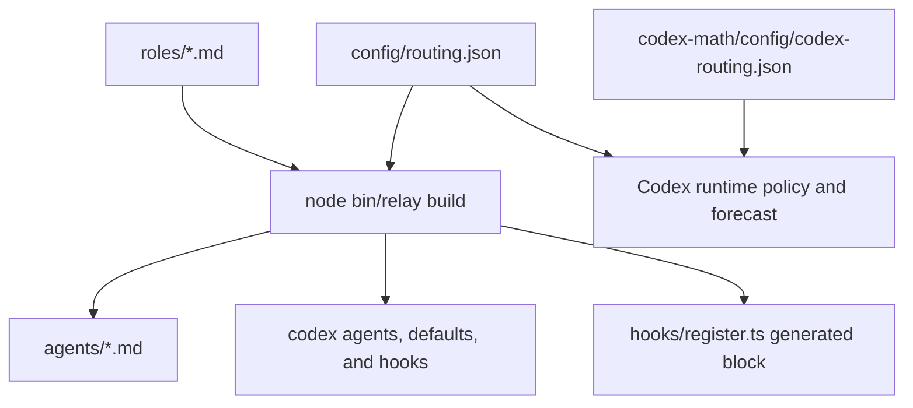

<!-- generated-by: gsd-doc-writer -->
# Configuration

Relay 0.4.0 keeps model routing, role instructions, and host setup in separate files. Change the source files, then rebuild generated definitions. Start with the [project README](../../README.md) or [getting started](../guides/getting-started.md). See the [architecture overview](../architecture/overview.md) for component relationships.

## Config file format

The routing files are JSON. Role files are Markdown with YAML frontmatter. Shared skills use Markdown with only `name` and `description` in their frontmatter.

| Source | Purpose |
|---|---|
| [`config/routing.json`](../../config/routing.json) | Shared tier models, Claude built-in routing, budget policy, lane limits, and forecast weights. |
| [`roles/*.md`](../../roles) | Role descriptions, tiers, tools, turn limits, and instructions. |
| [`codex-math/config/codex-routing.json`](../../codex-math/config/codex-routing.json) | Separately maintained Codex role registry, window policy, reset-credit advice, and forecast priors. |
| [`codex-math/config/codex-harness.json`](../../codex-math/config/codex-harness.json) | Codex model, effort, metering, and window data used by the forecast and routing library. |
| [`skills/`](../../skills) | Shared workflows and their supporting references. |



From the Relay checkout, regenerate definitions with:

```bash
node bin/relay build
node bin/relay build --check
```

[`scripts/build.mjs`](../../scripts/build.mjs) generates `agents/*.md`, `codex/agents/*.toml`, `codex/config.snippet.toml`, `codex/hooks.json`, `codex/hooks.plugin.json`, and the `<relay:generated>` block in `hooks/register.ts`. Do not edit these outputs by hand. The build does not regenerate the Codex role registry in `codex-math/config/codex-routing.json`; update that source separately when adding or changing a role's registry tier.

## Defaults

These values come from the checked-in configuration. They are Relay defaults, not statements about a host's current model availability or account limits.

### Tier routing

| Tier | Claude model / effort | Codex model / effort |
|---|---|---|
| `cheap` | `haiku` / `low` | `gpt-6-luna` / `low` |
| `mid` | `sonnet` / `medium` | `gpt-6.1-sol` / `medium` |
| `strong` | `opus` / `high` | `gpt-6-astra` / `high` |

`defaultSubagentTier` is `mid`. The shared `unrouted` map routes Claude's `general-purpose`, `claude`, and `Plan` agents to `mid`, and `Explore` to `cheap`. Other plugins keep their own agent frontmatter.

Codex dispatch must request the chosen model and reasoning effort explicitly through supported host fields. Clean Relay workers use `fork_turns: "none"`; full-history children inherit the parent model and effort and cannot accept overrides. The [Codex host reference](../../skills/using-relay/references/codex.md) describes this dispatch contract.

Generated Codex agent TOMLs contain `name`, `description`, and `developer_instructions`. They contain no model, effort, sandbox, or tool-policy override keys. The generated project default is:

```toml
[agents]
default_subagent_model = "gpt-6.1-sol"
default_subagent_reasoning_effort = "medium"
```

These defaults backstop omitted spawn choices. They do not change the parent session model or personal settings. In [`routeSpawn`](../../codex-math/lib/budget.mjs), an explicit recognized model determines the tier before the role registry or default tier; budget caps still apply. A fallback agent type can carry role instructions without receiving role-name-specific hook recognition.

### Shared budget policy

| Key | Default |
|---|---|
| `budget.fiveHour.tight` / `.critical` | `60` / `85` percent used |
| `budget.sevenDay.tight` / `.critical` | `80` / `95` percent used |
| `budget.staleAfterMinutes` | `360` |
| `budget.tight.capStrongTo` | `mid`; `architect` is exempt |
| `budget.critical.capStrongTo` | `mid`; no exemptions |
| `budget.critical.denyNewSpawns` | `implementer`, `implementer-fast`, `implementer-deep`, `test-author` |
| `budget.critical.hide` | `implementer-deep` |

[`scripts/relay-budget.mjs`](../../scripts/relay-budget.mjs) uses the shared thresholds for both hosts. A Codex window lasting at least seven days uses the shared seven-day thresholds. Missing or stale readings produce `unknown`; the Codex spawn hook treats `unknown` as `tight`.

### Codex-specific policy

The Codex registry currently assigns `teacher` and `reverse-engineer` to `mid`. The other assignments match the role table below. It is a source file, separate from generated TOMLs.

| Key in `codex-math/config/codex-routing.json` | Default |
|---|---|
| `tiers.*.speed` | `standard` |
| `budget.windows.primary.tight` / `.critical` | `60` / `85` |
| `budget.windows.secondary.tight` / `.critical` | `80` / `95` |
| `budget.weekly.tight` / `.critical` | `80` / `95`, for any window lasting at least seven days |
| `budget.degradeOrder` | `speed`, then `effort`, then `model` |
| `budget.tight` and `.critical` | Standard speed, effort cap `medium`, strong tier capped to `mid`; only tight usage exempts `architect` |
| `budget.resetCredit.consumeWhenWaitMinutesAtLeast` | `60` minutes |
| `budget.resetCredit.keepAtLeast` | `0` |
| `budget.creditsExhaustedIsCritical` | `true` |

These keys serve the Codex math library. The integrated [`hooks/codex-spawn.mjs`](../../hooks/codex-spawn.mjs) reads the Codex registry, replaces its tier models and efforts with shared values, and overlays shared tight/critical role policy. Its budget level comes from the shared budget reader described above. Reset-credit advice does not consume a credit.

### Lane and forecast settings

| Shared key | Default |
|---|---|
| `lanes.maxLaneTasks` | `6` tasks per implementation lane |
| `lanes.maxParallelLanes` | `4` implementation lanes |
| `forecast.tierWeight` | `cheap: 1`, `mid: 3`, `strong: 7` |
| `forecast.riskFactor` | `low: 0.8`, `medium: 1`, `high: 1.4` |
| `forecast.fixRoundProbability` | `low: 0.2`, `medium: 0.5`, `high: 0.8` |
| `forecast.fixRoundCost` | `0.35` of the lane's work |
| `forecast.defaults.pctPerUnit` | `1` percent of the five-hour window per weight unit |
| `forecast.defaults.minutesPerUnit` | `4` minutes per weight unit |
| `forecast.windowHours` | `5` |

A task's weight is `tierWeight[tier] × riskFactor[risk]`. Shared default rates are placeholders until calibration supplies samples. Research helper limits do not use `maxParallelLanes`.

[`lib/codex-integration.mjs`](../../lib/codex-integration.mjs) takes tier models, lane limits, and `tierWeight`, `riskFactor`, `fixRoundProbability`, and `fixRoundCost` from the shared file. Codex forecasts retain the following Codex-specific priors:

| Codex forecast key | Default |
|---|---|
| `forecast.prior.tokensPerUnit` | `70000` for each tier |
| `forecast.prior.tokenMix` | `input: 0.03`, `cachedInput: 0.965`, `output: 0.005` |
| `forecast.prior.effortOutputMultiplier` | `low: 1`, `medium: 1.5`, `high: 2.5`, `xhigh: 4`, `max: 6`, `ultra: 8` |
| `forecast.prior.minutesPerUnit` | `4` |
| `forecast.metering` | `included` |

`forecast.prior.windowCapacityCredits` contains account-plan estimates: `plus`, `business`, `team`, and `unknown` each use `primary: 210`, `secondary: 1400`; `self_serve_business_prolite` uses `primary: 6200`; `pro` uses `primary: 15000`; `promax` uses `primary: 60000`. Treat these as forecast priors with the qualifications recorded in the source comments. They are not guaranteed account entitlements. Calibration stores host-specific samples under the Relay state directory.

## Role frontmatter

Edit the source under [`roles/`](../../roles), then rebuild. The builder requires `name` to match the filename, `tier` to be `cheap`, `mid`, or `strong`, and a nonempty `description`.

| Field | Effect |
|---|---|
| `tier` | Selects the host model and default effort from shared routing. |
| `effort` | Optional Claude effort override; otherwise use the tier effort. |
| `tools` | Optional Claude tool allowlist. It does not create unavailable tools. |
| `readonly` | When true, generated Claude definitions disallow `Edit` and `NotebookEdit`; Codex instructions receive a report-only write restriction. Role instructions impose further limits. |
| `maxTurns` | Optional generated Claude turn limit. It is not emitted as a Codex TOML setting. |
| `color` | Optional generated Claude display color. |

| Role | Tier | `readonly` | `maxTurns` |
|---|---|---|---|
| `architect` | `strong` | Not set | `40` |
| `conductor` | `mid` | Not set | `300` |
| `implementer-fast` | `cheap` | Not set | `40` |
| `implementer` | `mid` | Not set | `80` |
| `implementer-deep` | `strong` | Not set | `80` |
| `reviewer` | `mid` | `true` | `25` |
| `scout` | `cheap` | `true` | `20` |
| `test-author` | `mid` | Not set | `30` |
| `teacher` | `mid` | `true` | `40` |
| `reverse-engineer` | `mid` | `true` | `40` |

Both research roles list `Read, Grep, Glob, Bash, Write, WebFetch, WebSearch`. They may inspect sources and write only an explicitly assigned report within host permissions. They may not change project code, commit, run tests, or start implementation workflows. Native Claude child roles have no `Agent` tool and research serially. Codex TOMLs do not grant a sandbox or new tool permissions.

## Architecture design request inputs

[`relay-design`](../../skills/relay-design/SKILL.md) uses the existing `architect` role. There is no additional role registry entry, model tier, terminal subcommand, or design configuration file. The interactive lead keeps the session model; dispatched architect instances use the existing `strong` tier and host routing.

| Input in the conversation | Default and meaning |
|---|---|
| Problem or design question | Required; use current context when already supplied. |
| Requirements, evidence, and settled decisions | Optional supplied paths, URLs, or prior discussion. Reuse them before asking questions. |
| Explanation preference | Optional familiarity, depth, examples, or diagram request. |
| `max-helpers` | Integer `0` through `3`; default ceiling `3`. Actual global capacity and budget can reduce it to zero. |
| Document destination | Use a supplied path or project conventions. For a requested new document without a location, use `docs/relay/designs/YYYY-MM-DD-<topic>.md`. A chat comparison need not create files. |

These inputs accept natural-language equivalents and are not CLI flags. Helpers receive an explicit `mode=research-only` or `mode=design-review` assignment and cannot delegate. Those modes are internal responsibilities of the architect, not additional roles. Unknown capacity means serial work; critical usage permits no helpers. The helper ceiling is separate from implementation lane limits.

The architect's Claude allowlist includes `WebFetch` and `WebSearch`. Native Claude children have no `Agent` tool and work serially. Host permissions still determine availability. Architect instructions permit scoped design documents, decisions, plans, and reports while prohibiting project-code edits and commits. The absence of `readonly: true` in its metadata does not authorize implementation. See the [design guide](../guides/architecture-design.md) and [helper policy](../../skills/relay-design/references/research.md).

## Teaching and research request inputs

These are human-readable fields for [`research-and-explain`](../../skills/research-and-explain/SKILL.md). Accept equivalent natural language. They are not terminal flags and do not add a CLI parser. Both roles work independently; a handoff is optional.

| Input | Required / default | Meaning |
|---|---|---|
| Topic or question | Required | The subject to explain or reconstruct. Paths, URLs, text, and handoffs are optional evidence. |
| `focus` | Optional; `technical` | Accept `technical` or `business+technical`. The latter adds stakeholders, outcomes, and business rules to the same technical evidence. |
| Learner context | Optional | Use current topic familiarity, goal, preferred depth, and pace. Do not infer expertise from a job title or unrelated knowledge. |
| `max-helpers` | Optional; `3` | Integer `0` through `3`. A ceiling, not a target. Zero supports fully serial research. |
| `report` | Optional; respond in the conversation | Write only to an explicitly assigned path within the host sandbox. Return evidence for caller capture if saving is unavailable. |
| `mode` | Internal; `lead` | Helpers receive `research-only`. They cannot interview the learner, extend scope, or dispatch agents. Users need not supply this field. |

An invalid `focus` or `max-helpers` requires correction before dependent research or dispatch. Negative, fractional, or greater-than-three helper values are invalid.

For example, send this as a request in the conversation:

> Explain the cache hit path; focus=technical max-helpers=0. Just explain.

Before each permitted helper dispatch, the lead uses the smaller of remaining global slots and `max-helpers` minus its own active helpers. Count the lead, ancestors, and other active agents against host capacity. Unknown remaining capacity means zero helpers. Forbidden nesting or an unavailable dispatch tool also means zero. Start no research helpers at critical usage; prefer solo work at unknown or tight usage. This is lead-managed policy under host limits, not a hard global hook or reserved capacity. It is separate from implementation lane limits.

The shared engine has one bundled teaching method. It provides no named profiles, custom method resolver, or saved learner history. See the [teaching and reverse-engineering guide](../guides/teaching-and-reverse-engineering.md) for entry points and examples.

## Language and teaching content

Runtime role and skill instructions are strict STE-style drafts under the shared [`language-guide.md`](../../skills/using-relay/references/language-guide.md) and [`software-glossary.md`](../../skills/using-relay/references/software-glossary.md). Teacher explanations use the adaptive STE-based method in [`teaching-method.md`](../../skills/research-and-explain/references/teaching-method.md): adapt words, detail, examples, analogies, diagrams, and pace to the question and topic familiarity.

Keep exact code, commands, paths, identifiers, configuration keys, API names, output markers, quotations, and evidence intact. Language changes must preserve role responsibilities, restrictions, stop conditions, and output limits. A draft assessment does not establish audited ASD-STE100 conformance or a passed live host evaluation.

To change terminology, edit the shared glossary or language guide as source content. To change the teaching method, edit the single bundled method reference. Update affected role or skill prose where necessary, rebuild generated role definitions, and review the resulting contracts. Do not add runtime profiles or change model settings to select an explanation style.

## Host setup

[`scripts/relay-setup.mjs`](../../scripts/relay-setup.mjs) applies project integration. It does not modify personal model choices.

For Claude Code, print the recommended settings from the Relay checkout:

```bash
node bin/relay setup claude
```

The settings are valid project configuration:

```json
{
  "worktree": { "baseRef": "head" },
  "subagentPromptCacheTtl": "1h"
}
```

To merge these settings into a target repository, run the installed CLI there. Replace `<absolute-relay-root>` with the resolved installed Relay root:

```bash
node "<absolute-relay-root>/bin/relay" setup claude --write-project
```

This writes the target repository's `.claude/settings.json`. Native Claude hooks load through the plugin system; Codex project hooks are not part of Claude setup.

For Codex, choose the mode that matches installation:

```bash
# Native plugin already supplies skills and hooks.
node bin/relay setup codex /path/to/project --plugin

# Project fallback supplies hooks and skill links.
node bin/relay setup codex /path/to/project
```

Both modes copy generated agents into the project's `.codex/agents/` and create `.codex/config.toml` with agent defaults only when it is absent. Existing configuration is preserved and missing defaults are printed for manual merge. Changed agent copies are preserved; proposed replacements use `.relay-pending` files.

Fallback setup writes project hooks and links shared skills into `.agents/skills/`. When hooks already differ, it writes `hooks.relay.json` for review and merge. Native setup skips project hook installation and fallback skill links. Do not run both hook paths: native setup refuses detected Relay fallback hooks to prevent duplicates. Start a new Codex session and review hook trust through `/hooks`; setup cannot grant trust.

## Environment variables

No `.env` file or secret value is required for the CLI. The following optional environment values have consumers in the source. None is a teaching profile or a model-style setting.

| Variable | Required | Default | Description |
|---|---|---|---|
| `RELAY_HOME` | No | `~/.relay` | CLI budget and calibration state directory. The Claude mod writes its snapshot to `~/.relay/budget.json` independently, so a different CLI home does not move that mod output. |
| `RELAY_HARNESS` | No | Detect Codex session markers; otherwise `claude` | Select `claude` or `codex`. An explicit CLI `--harness` or `--codex` selection takes precedence. |
| `RELAY_CODEX_BIN` | No | Search `PATH`, known app locations, then the Codex home plugin binary | Select the Codex executable. The budget command's `--codex-bin` takes precedence. |
| `RELAY_CLAUDE_BIN` | No | `claude` on `PATH`, then `CLAUDE_CODE_EXECPATH` | Select the Claude executable for marathon legs. |
| `CODEX_HOME` | No | `~/.codex` | Locate rollout fallback data and a plugin CLI candidate. This variable alone does not select the Codex harness. |
| `NO_COLOR` | No | Unset | Disable terminal board color when set to a nonempty value. |

The host may supply `CODEX_THREAD_ID` or `CODEX_SESSION_ID` for harness detection, and `CLAUDE_CODE_EXECPATH` as an executable fallback. `PATH` supplies executable search directories. Relay sets `RELAY_MARATHON_LEG` for its child legs; `RELAY_MARATHON_FAST=1` skips a marathon wait loop for controlled test runs. These are not required setup values.

## Required vs optional settings

Use the complete checked-in routing files. Relay reads them directly; it does not merge an arbitrary partial JSON file with default configuration. No environment variable substitutes for a missing routing file.

The builder rejects role sources with a mismatched `name` (`name must be "<filename>"`), an unsupported `tier` (`tier must be one of cheap, mid, strong`), or a missing description (`description is required`). A missing tier/host entry fails with `routing.json has no <harness> entry for tier "<tier>"`. An invalid harness fails with `unknown harness "<value>" (expected claude or codex)`.

Codex setup rejects malformed existing config or hook JSON before installation. Claude project setup requires a Git repository. Research requests require a subject and valid focus/helper fields, but they require no handoff, report path, profile, learner interview, or model change.

## Per-environment overrides

Relay has no development/staging/production `.env` loader. Use explicit CLI harness selection or the optional environment overrides above for a particular invocation. Project `.claude/` and `.codex/` integration belongs to the target checkout; source routing and role files belong to the installed Relay root.

For example, from the Relay checkout, read the Codex budget with a selected executable:

```bash
RELAY_CODEX_BIN=/absolute/path/to/codex node bin/relay budget --harness codex
```

Keep host-specific state separate: CLI Claude snapshots and calibration use `RELAY_HOME/budget.json` and `RELAY_HOME/calibration.json`; Codex uses the `codex/` subdirectory. When `RELAY_HOME` is unset, substitute `~/.relay`.

See [development](../guides/development.md), [testing](../testing/README.md), and [contributing](../../CONTRIBUTING.md) before changing configuration sources or their generated outputs.
