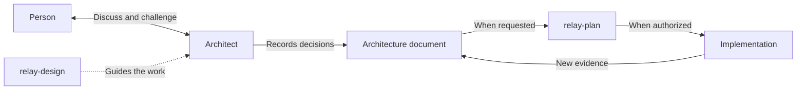

# Design architecture with Relay

Use the existing architect as a teammate to understand a problem, challenge assumptions, research alternatives, and recommend a solution. The `relay-design` skill guides that work and produces architecture documentation when requested. It adds no new role or research engine.

| Host | Shared skill | Native role |
|---|---|---|
| Claude Code | `/relay:relay-design` | `relay:architect` |
| Codex | `$relay-design` | `relay-architect` |

Plain requests such as “Compare architectures for this ingestion service” can select the skill through its description. Selection depends on the host and model; explicit invocation remains available. A focused question such as “What is dependency injection?” can use teaching or a direct answer.

These invocations belong in your agent conversation. There is no `relay design` terminal subcommand. The native role names identify agent definitions that the host can dispatch.

## Choose the work you need

| Your question | Entry point | Result |
|---|---|---|
| “How does this system work today, and why?” | `relay-reverse-engineer` | A reconstruction grounded in the existing system. |
| “Help me understand this concept or design.” | `relay-teach` | An explanation adapted to your knowledge and question. |
| “How should we build or change this system?” | `relay-design` | A reasoned proposal, in chat or a requested architecture document. |
| “Turn this accepted design into tasks.” | `relay-plan` | An implementation plan that preserves the design decisions. |

Start at the relevant step. You do not need to run the other workflows first.

## One role, one skill

The **architect role** defines how the agent thinks and works with you: understand constraints, challenge assumptions, compare approaches, and explain decisions. The **design skill** supplies the procedure and document guidance for an architecture task. The same architect also has planning and review responsibilities.

Both hosts read the same skill. Relay generates their architect definitions from one role source. Supporting references contain the design method, research rules, document guidance, template, and review criteria. They are loaded as needed and are not extra skills or roles.

## Work with the architect

Supply the problem and any useful requirements, files, or URLs. The architect reuses prior decisions and asks only about gaps that affect the design. It compares credible options against the actual constraints. It explains the big picture and follows one example through responsibilities, triggers, state changes, and failures. Technical details refer back to that same example.

Examples:

```text
Compare the simplest options for adding durable imports to this service.
We have one operations engineer. Challenge unnecessary complexity.
Keep this discussion here; max-helpers=0.
```

```text
Design the import pipeline from requirements.md. Research comparable approaches.
Save the architecture in docs/architecture/imports.md. Include failure recovery,
alternatives, and acceptance scenarios. Leave implementation for later.
```

```text
Update docs/architecture/imports.md for the new retry requirement.
Preserve the accepted API contract. Identify which decisions need revisiting.
```

Research uses available local and web tools. External examples include their constraints and limits of comparison. Missing or conflicting evidence stays visible. The architect can work without a teacher or reverse-engineer. A supplied handoff is optional evidence.

The architect compares the simplest credible solution with meaningful alternatives. Patterns and principles such as separation of concerns, loose coupling, testability, composition, KISS, and DRY guide those choices. Each abstraction or service boundary must solve an actual problem and justify its cost. The design considers relevant ownership, contracts, security, failure recovery, operations, and future changes.

For example, a small team adding durable imports might compare a database-backed job queue with a separate broker. The explanation should connect the choice to restart recovery, workload, and operational capacity. An impressive product's use of a broker is evidence to investigate; the design still needs to show why that approach fits this team.

## Shape the request

| Supply in the conversation | How it is used |
|---|---|
| Problem and constraints | Establish the outcome, existing system, scale, team capacity, and important trade-offs. Supply what you know; unknowns remain explicit. |
| Paths, URLs, or prior decisions | Ground the recommendation in evidence and preserve decisions already settled. |
| Your familiarity and desired depth | Adapt vocabulary, examples, diagrams, and technical detail. For example: “I know SQL, but I have not built background workers.” |
| `max-helpers=0..3` | Set an optional helper ceiling. The default is three; zero keeps the work serial. Invalid values need correction before dispatch. |
| Output preference | Keep a comparison in chat, name a document to update, or request a new document. |

These are conversation inputs, not new CLI flags or configuration keys. Business context is included when requested or needed to explain a requirement. There is no required business interview for a technical design question.

## Roles and boundaries

The entry skill acts as the architect in the current conversation. It does not start a child lead. The architect's plan and final branch review duties remain available. It can also answer a bounded research assignment or assess a design in a fresh context.

Helpers are optional. `max-helpers` accepts integers from zero to three; three is the default ceiling. Actual host capacity and budget may reduce this to zero. Native Claude child roles work serially. Research and design-review helpers cannot delegate. The existing scout and architect roles cover these jobs.

The interactive lead keeps the session's selected model. The architect's `strong` tier applies when it is dispatched as a role under Relay's routing rules. Selecting a design or explanation style does not switch the main session model.

Design writes only requested architecture documents and related decision records. It does not change project code, run tests, install dependencies, create worktrees, or commit. An experiment is a separate authorized activity. A review does not grant permission to implement.

## Documents and handoff

Follow the project's documentation conventions. If no location exists and a new document is requested, the default is `docs/relay/designs/YYYY-MM-DD-<topic>.md`. A short comparison can remain in the conversation.

The document records the problem, constraints, alternatives, chosen responsibilities and contracts, one concrete flow, risks, and validation. Significant decisions retain their reasons and history. The current architecture overview describes implemented behavior; a proposal describes intended changes. Status and acceptance are explicit.



For consequential designs, a fresh review asks whether another engineer could plan without guessing a material decision. When only self-review is possible, the result says so. Neither kind of review proves runtime behavior.

Review results are `READY`, `READY_WITH_CONCERNS`, or `NEEDS_DECISION`. They describe planning readiness. A review can identify a missing contract or recovery decision while leaving routine implementation details to the builder. The existing architect performs this responsibility; there is no additional design-review role.

When ready, request planning from the design path:

| Host | Request |
|---|---|
| Claude Code | `/relay:plan docs/architecture/imports.md` |
| Codex | `$relay-plan docs/architecture/imports.md` |

Planning keeps the accepted decisions and scenarios. It adds task details and checks, including necessary architecture-document updates. It does not replace the design with a smaller spec or reopen settled questions.

## Keep the architecture useful after implementation

| Document | What belongs there |
|---|---|
| Current architecture overview | Verified implemented behavior and the important flows. |
| Design document | Intended changes, constraints, contracts, alternatives, and acceptance scenarios. |
| Decision records | Significant choices, their reasons and consequences, and when to reconsider them. |
| Implementation plan | Tasks and checks, with references to the design used for planning. |

Update an existing document in place when the requirement changes. Keep stable decision identifiers. When replacing a consequential decision, retain the old record and link its replacement. Record whether the proposal is draft, accepted, implemented, or superseded. Acceptance must have a stated basis; it does not prove implementation.

When implementation exposes a false assumption, bring that evidence back to the design. Resolve affected decisions and update the implementation plan where needed. Update the current overview only from verified behavior. This maintenance happens through requested agent work; Relay does not watch code changes and synchronize documents automatically.

Use the [document template](../../skills/relay-design/references/design-template.md) at the depth the change needs. A small decision does not need a full set of architecture documents.

## Availability and verification

The shared [skill](../../skills/relay-design/SKILL.md), [architect source](../../roles/architect.md), and [evaluation record](../relay/evaluations/2026-10-30-architect-design.md) describe the contract and verification coverage. Updating source files does not refresh an already installed plugin cache; use the installation's normal update process and start a new session to discover the new skill.
