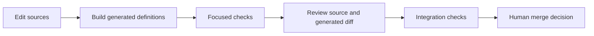

<!-- generated-by: gsd-doc-writer -->
# Development

Relay is a dependency-free Node CLI plus shared role and skill sources for Claude Code and Codex. This guide covers changes to Relay itself. See [getting started](getting-started.md) for installation and [configuration](../configuration/README.md) for settings and defaults.

## Local setup

Use Node.js `>=20`, Git, and npm. CI uses Node.js 22. There are no runtime dependencies to install and no compile step before using the CLI.

1. Fork the repository if you need your own remote, then clone the repository or your fork:

   ```bash
   git clone https://github.com/cube-digital/relay.git
   cd relay
   ```

2. Read [AGENTS.md](../../AGENTS.md) and inspect the CLI:

   ```bash
   node bin/relay --help
   ```

3. Make a scoped change on a descriptive branch. The remote default branch is `main`. No separate contributor branch-name or commit-message convention is documented.

Relay deliberately has no `CLAUDE.md` at the plugin root. Keep shared repository instructions in `AGENTS.md`.

## Source and generated files

| Edit | Purpose |
|---|---|
| [`roles/*.md`](../../roles) | Host-neutral role metadata and instructions. |
| [`config/routing.json`](../../config/routing.json) | Shared model tiers, budget policy, lane limits, and forecast weights. |
| [`codex-math/config/codex-routing.json`](../../codex-math/config/codex-routing.json) | Separately maintained Codex role registry, window policy, and forecast priors. |
| [`skills/`](../../skills), [`commands/`](../../commands) | Shared workflows, supporting references, and command wrappers. |
| [`lib/`](../../lib), [`scripts/`](../../scripts), [`bin/relay`](../../bin/relay) | CLI behavior, reusable logic, and dispatch. |
| [`hooks/`](../../hooks) | Command hooks and the Claude mod; preserve the generated routing block. |
| Plugin manifests and [`package.json`](../../package.json) | Host discovery, package resources, and release metadata. |

[`scripts/build.mjs`](../../scripts/build.mjs) generates these outputs:

- `agents/*.md` for Claude Code.
- `codex/agents/*.toml`, `codex/config.snippet.toml`, `codex/hooks.json`, and `codex/hooks.plugin.json`.
- The `<relay:generated>` block in `hooks/register.ts`.

Do not hand-edit `agents/`, `codex/`, or that marked block. Regenerate them from the sources. The Codex registry in `codex-math/config/codex-routing.json` is not a generated output.



## Build commands

These are all npm scripts in `package.json`:

| Command | Description |
|---|---|
| `npm run build` | Run `scripts/build.mjs` to regenerate host artifacts and check skill portability. |
| `npm run check` | Run the builder with `--check`; report stale outputs without writing them. |
| `npm test` | Run the Node test suite with `node --test test/*.test.mjs`. |

The direct build forms used in repository instructions are:

```bash
node bin/relay build
node bin/relay build --check
```

Inspect both the source and generated diff after building. A successful build proves generation consistency; it does not prove live discovery, hook trust, or research behavior in either host.

## Change a role or shared skill

1. Edit the role under `roles/`. Preserve its responsibilities, stop conditions, report scope, and output contract unless the change intentionally revises them. The builder requires a matching `name`, a valid `tier`, and a description.
2. For a new role, add its source file. Add or update the entry in the separate Codex `roles` registry so role-name routing recognizes it. Check the shared tier model choices in `config/routing.json`.
3. If the capability needs a public entry point, add or change its shared skill and the relevant discovery or packaging sources. Keep bundled references resolvable from the installed Relay root, including outside this checkout.
4. Run `node bin/relay build`. Review generated Claude and Codex definitions, routing changes, and exact literals.
5. Use the relevant build, package, routing, and hook tests. Record live-host checks separately when a change needs them.

Codex definitions keep model and effort selection explicit at dispatch. Do not add model/effort override keys to generated TOMLs. Read-only definitions and role instructions restrict edits and assigned report output; they do not create an absolute sandbox guarantee or grant missing host permissions.

Shared skill frontmatter contains only `name` and `description`. The description states when to use the skill. Name an action, such as “dispatch the reviewer agent,” or give both hosts' supported forms. Keep `SKILL.md` short and move supporting detail into references. Both hosts load the same source instructions.

For discovery, setup, manifest, or package-resource changes, exercise the existing package tests:

```bash
node --test test/package.test.mjs test/build.test.mjs
```

These checks cover relocated package resources, fallback discovery, native setup behavior, and generated definitions. They do not establish that an installed session has loaded the candidate or trusted its hooks.

## Language and teaching changes

Use the shared [language guide](../../skills/using-relay/references/language-guide.md) and [software glossary](../../skills/using-relay/references/software-glossary.md). Runtime instructions are strict STE-style drafts. Teacher explanations use the [adaptive teaching method](../../skills/research-and-explain/references/teaching-method.md), with depth, words, examples, and pace suited to the current question and topic familiarity.

Edit the glossary, guide, or single bundled method as source content. Update affected role or skill prose, rebuild generated definitions where relevant, and review the old and new contracts. Preserve exact code, commands, paths, identifiers, API names, configuration keys, output markers, quotations, and evidence. Do not add runtime teaching profiles or change session models to select an explanation style.

Keep language review separate from automated checks and live evaluation. A strict STE-style draft assessment is not audited ASD-STE100 conformance. The [teaching and reverse-engineering guide](teaching-and-reverse-engineering.md) explains the research interfaces.

## Code style and hook contracts

The CLI uses plain Node ES modules without added dependencies. Follow the surrounding file style. The repository has no configured ESLint, Prettier, Biome, or `.editorconfig`, and no npm lint or format script.

Hooks must fail open on errors. Preserve the existing host protocol for deliberate denials: command hooks use exit code `2` with a reason on stderr; the Codex spawn hook emits its native permission-decision response. Unexpected command-hook errors exit `0`. Keep the mod's gating `.catch(... => next(e))` paths.

The Claude mod in [`hooks/register.ts`](../../hooks/register.ts) runs without Node. Add no `node:` imports and perform filesystem access only through `$`. Keep logic pure where possible and cover changes in [`hooks/register.test.ts`](../../hooks/register.test.ts).

The protected-test hook checks supported editor and shell write forms against `.relay/protected-tests.txt`. Preserve its guards and failure behavior. These checks complement host permissions; they are not a sandbox for every possible program.

## Verification

Follow [`skills/qa-mindset`](../../skills/qa-mindset/SKILL.md): test changed observable behavior at the lowest useful layer, reuse existing coverage, and avoid repeating unchanged checks. Prove a new regression test can fail for the intended reason. Do not derive expected results by running the implementation.

| Area | Existing checks |
|---|---|
| Generation and portable skills | `test/build.test.mjs` |
| Package resources, discovery, and setup preservation | `test/package.test.mjs` |
| CLI parsing, routing, plans, lanes, and worktrees | `test/units.test.mjs`, `test/lanes.test.mjs`, `test/worktrees.test.mjs` |
| Budget, forecast, calibration, and long runs | `test/codex-budget.test.mjs`, `test/forecast.test.mjs`, `test/marathon.test.mjs` |
| Command hooks and write/test guards | `test/hooks.test.mjs`, `test/hook-reliability.test.mjs` |
| Claude mod engine behavior | `hooks/register.test.ts`, through the Claude plugin test command |

CLI integration tests use real temporary Git repositories from [`test/helpers.mjs`](../../test/helpers.mjs). Prefer those fixtures over mocking Git. Keep tests independent of a developer's account and personal settings.

Run a relevant file first, for example:

```bash
node --test test/hooks.test.mjs
```

Before finishing, [AGENTS.md](../../AGENTS.md) requires:

```bash
npm test
node bin/relay build --check
```

When `hooks/register.ts` changes, including regenerated routing, also run:

```bash
claude plugin validate .
claude plugin test .
```

The plugin test command can be unavailable: Claude Code 2.1.27 has been recorded reporting an unknown `test` command. Record the executable version, command, and blocker when that occurs. Do not count an unavailable check as a pass. The Node npm test script does not run `hooks/register.test.ts`.

CI runs `npm test` and `node bin/relay build --check` on pushes and pull requests in [`.github/workflows/ci.yml`](../../.github/workflows/ci.yml). See [testing](../testing/README.md) for check details and evidence limits. Teaching scenarios A–H remain unexecuted in the dated [evaluation record](../relay/evaluations/2026-10-25-teaching-and-reverse-engineering.md).

For prose-only changes, review source claims manually, resolve relative links, and inspect diagram syntax and labels. Run repository-required checks; do not add unit tests that merely repeat documentation text.

Never edit, weaken, skip, or delete protected acceptance tests to make a change pass. If a protected test conflicts with the specification, report `BLOCKED` with the specification, expectation, and observed behavior. Use `RELAY_RERUN=1` only for a genuinely flaky rerun and record why.

## Branches, reports, and pull requests

Relay implementation runs use `relay/<slug>/integration` and `relay/<slug>/lane-<id>`. Each lane works in its assigned worktree and preserves others' changes. The final integration branch is presented for a human merge decision.

Run artifacts live under `.relay/runs/<slug>/`, including briefs, reports, review packages, and the ledger. Give agents bounded file ownership and exact report paths. Read-only research and review roles write only assigned reports within actual host permissions; if saving is unavailable, return evidence for caller capture.

A useful PR describes the problem, resulting behavior, affected source/generated files, and checks with results or blockers. Include relevant evidence for discovery or language changes. No PR or issue template is present; see [CONTRIBUTING.md](../../CONTRIBUTING.md) for the short submission checklist.

## Release and plugin refresh

The current package and both plugin manifests are `0.3.0`. For an intentional release, follow the [README release guidance](../../README.md#releasing): update `package.json`, `.claude-plugin/plugin.json`, and `.codex-plugin/plugin.json` together. Keep the RPC client version in `lib/codex-rpc.mjs` aligned. Verify version agreement before tagging or publishing. Use release commands supported by the installed host.

New capabilities need the appropriate packaged release and installed-plugin refresh before they become available from a user's plugin cache. Editing the checkout does not show that an existing installation has updated. Verify the installed candidate and start a new session when setup requires it. Do not change release versions merely for an unrelated documentation edit.
