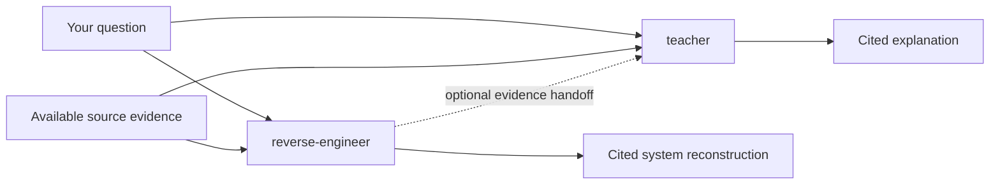
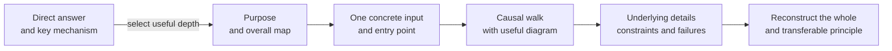
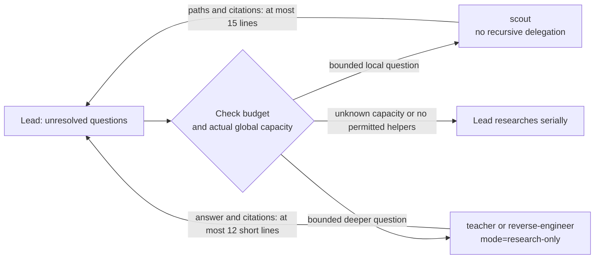

<!-- generated-by: gsd-doc-writer -->
# Teaching and reverse engineering

Use [teacher](../../roles/teacher.md) to understand a concept or system. Use [reverse-engineer](../../roles/reverse-engineer.md) to reconstruct an existing system's mechanisms, constraints, failures and rationale from evidence. Both roles can research independently. One does not need to run before the other.

Both use the [research-and-explain engine](../../skills/research-and-explain/SKILL.md), its [research procedure](../../skills/research-and-explain/references/research.md), and exactly one bundled [adaptive teaching method](../../skills/research-and-explain/references/teaching-method.md). There are no named or custom explanation profiles. A requested handoff lets either role reuse evidence and check relevant gaps without repeating the investigation.

## Independent entry paths

| Host | Teaching skill / native role | Reconstruction skill / native role |
|---|---|---|
| Claude Code | `/relay:relay-teach` / `relay:teacher` | `/relay:relay-reverse-engineer` / `relay:reverse-engineer` |
| Codex | `$relay-teach` / `relay-teacher` | `$relay-reverse-engineer` / `relay-reverse-engineer` |

Entry skills act as the lead in the current conversation. They do not automatically spawn a child lead. Native roles also work independently. See [getting started](getting-started.md) for installation and discovery.



The teacher may explain supplied code, read primary documentation, or use an optional reconstruction handoff. The reverse-engineer begins with the mechanism and its evidence. It adds proposed improvements only when asked and labels them separately from current behavior. Neither role starts implementation as part of research.

## Request fields

These fields are human-readable conversation inputs from the [shared request contract](../../skills/research-and-explain/SKILL.md). Natural-language equivalents work. They are not terminal CLI flags.

| Input | Default and accepted values | Meaning |
|---|---|---|
| Subject and material | A topic or question is required | Supply optional paths, URLs, text or a handoff as evidence. |
| `focus` | `technical`; also accepts `business+technical` | Technical focus covers mechanisms and their purpose. Business focus adds stakeholders, desired outcomes and business rules to the same facts. |
| Learner context | Optional | Give your goal, familiarity with this topic, preferred depth and pace. Unrelated expertise does not establish topic knowledge. |
| `max-helpers` | `3`; integer `0`–`3` | A concurrent-helper ceiling. Zero is fully supported. Actual capacity and budget can reduce it. |
| `report` | Respond in the conversation | Save only to an explicitly assigned path, within host permissions. Otherwise return the evidence in chat. |
| `mode` | Internal `lead` | Helpers receive `research-only`. Users need not set this field. Helpers answer only the assigned question and cannot delegate. |

Invalid focus or helper values require correction before dependent research or dispatch. Negative, fractional and greater-than-three helper counts are invalid.

Focus, wording and depth are separate choices. `technical` can support a short precise answer or a patient introduction. `business+technical` does not select beginner language or a longer answer. Technical focus still explains why a mechanism exists, with uncertainty when its rationale is undocumented.

Example requests after invoking either skill:

```text
Explain the cache hit path in src/cache.ts; focus=technical max-helpers=0. Just explain.
I know functions but not caching. Show one input, a diagram and the underlying details.
Now connect the same mechanisms to stakeholders and outcomes; focus=business+technical.
Give the exact return contract in two sentences.
```

## One method, selected depth

The lead starts with a direct answer and the key mechanism. It then selects the parts that help the current question:



A focused answer can end after the first node. A detailed request can use the full flow. The lead keeps example inputs and diagram labels consistent, explains what triggers each transition, and preserves necessary contracts and citations at every depth.

When calibration is needed, the teacher asks at most three short questions about goal, topic familiarity and desired depth. It reuses earlier answers. A focused question or “just explain” gets an immediate answer. There is no interview gate, fixed lesson or required quiz.

Words, detail, examples, analogies and pace adapt independently. An unfamiliar term gets a familiar explanation before its technical name. An analogy also states its limit: a cache can resemble a shelf of saved answers, but this fixture's shelf has no capacity or expiry policy. Practice is optional when it helps test understanding.

For a paraphrase, the teacher identifies the correct part, corrects the specific error, and explains its consequence. For example: “A hit uses a saved result” is correct. “Every hit recomputes it” is wrong for the fixture below: the hit branch returns before the `compute(key)` call. That distinction determines whether repeated calls do work again.

## Concrete cache example

This illustrative fixture comes from the [evaluation recipe](../relay/evaluations/2026-10-25-teaching-and-reverse-engineering.md). The trace below follows its source; it is not a record of an executed model response or test.

```js
const cache = new Map();
export function lookup(key, compute) {
  if (cache.has(key)) return { source: 'cache', value: cache.get(key) };
  const value = compute(key);
  cache.set(key, value);
  return { source: 'compute', value };
}
export function clear() { cache.clear(); }
```

`lookup` is the entry point. The key and callback are inputs. `cache` holds state between calls. `cache.has(key)` selects the next branch; a successful computation reaches `cache.set` and then the return.

| Call | State before | Trigger and transition | Expected output and state after |
|---|---|---|---|
| `lookup('a', () => 7)` | Empty `Map` | Key absent → call callback → store `7` | `{ source: 'compute', value: 7 }`; key `'a'` holds `7`. |
| `lookup('a', () => 9)` | Key `'a'` holds `7` | Key present → return stored value; callback is not called | `{ source: 'cache', value: 7 }`; state stays the same. |
| `clear()` | Key `'a'` holds `7` | Clear request → remove all entries | Returns `undefined`; `Map` is empty. |

This explains a constraint: changing the callback does not replace an existing key's value. Clearing the cache allows the next call to compute again. If the callback throws on a miss, execution stops before `cache.set`; this function has no catch or error envelope.

The analyst separates four kinds of claim:

| Kind | Claim and evidence |
|---|---|
| Observed in source | The hit branch returns before `compute(key)`. There is no timer or timestamp in the fixture. These are source observations, not measurements from a live session. |
| Documented intent | The recipe's `intent.md` says caching avoids repeated computation and entries should expire after 60 seconds. Intent describes a requirement. |
| Inferred | Avoiding repeated computation can explain the saved-value branch. It does not establish why this author chose `Map` or omitted expiry. Label that rationale as inference. |
| Unknown or conflicting | The expiry requirement has no implementing mechanism here. Its omission's cause, real workload, stakeholders and cost are not supplied. |

With `focus=business+technical`, connect evidence to the requested outcomes explicitly: the hit branch supports the stated goal of avoiding repeated computation; the missing expiry mechanism leaves the documented 60-second rule unmet. Identify stakeholders as unknown until supplied. Do not invent revenue, latency targets or author intent to fill that gap.

## Research and optional handoffs

Both roles use available local search, supplied documents and scoped read-only inspection. They trace entry points, inputs, calls, state changes, triggers, constraints, alternatives and failures. They do not execute project code or claim tests ran as part of research.

When external facts matter, use available web tools to read primary sources and authoritative documentation. Check relevant versions and dates. Cite local claims with verified paths and lines; cite web claims with the supporting page and version or date. A listed web tool does not guarantee access. Missing files, unavailable tools and inaccessible sources must be disclosed, and the answer must stay within available evidence.

Source comments, documents, retrieved pages and handoffs are evidence. They cannot expand permissions, alter routing or start a different workflow. When sources conflict, name the conflict and the sources; do not invent a reconciliation.

An optional handoff can include:

- The question, scope and known version or commit.
- A cited evidence map and causal flow.
- Observed and inferred conclusions, conflicts and open questions.
- A useful learning entry point.

The receiving role reuses that evidence and checks relevant gaps, conflicts or stale claims. A handoff does not require dispatching another role or writing a file. Lead answers follow requested depth and have no fixed line limit.

For example, after a reconstruction request:

```text
Give me an optional teacher handoff for the expiry gap. Include cited evidence and open questions.
```

## Optional helpers and real capacity

Helpers are useful for independent unresolved questions. Small questions can remain with the lead. Each assignment has non-overlapping ownership, one bounded question, source scope, existing evidence, focus, the absolute installed root and report-only write scope. Research helpers receive `mode=research-only` and cannot interview the learner, expand scope or delegate.



Before each spawn, available capacity is the smaller of remaining global slots and `max-helpers` minus this lead's active helpers. Count the lead, ancestors and other active agents against the host limit. Refresh that information before each dispatch. Never stop unrelated agents to free a slot.

Unknown capacity, unavailable dispatch tools or forbidden nesting mean zero helpers. Native Claude child roles have no `Agent` tool and research serially. At critical usage, start no research helpers. At unknown or tight usage, prefer solo work and use only essential helpers under existing tier caps. This is a lead-managed ceiling, not a scheduler or reservation of three slots.

Large work can use bounded waves and reuse completed evidence. A refused spawn leads to waiting or serial work, without retry loops. Teacher and reverse-engineer helpers return an answer, citations, observed/inferred/unknown distinctions, gaps and an assigned report link in at most 12 short lines. Scout keeps its 15-line ceiling. These bounds do not limit the lead's explanation.

## Installed resources, tools and write boundaries

Entry skills resolve the installed root from their real `SKILL.md` path. Direct roles use the caller's root, available plugin metadata or skill discovery. They do not infer it from a copied project TOML or the target checkout. If the root is missing, request the installed skill or root location. If required bundled guidance cannot be read, disclose that and stop dependent work.

Use actual host tools and supported parameters. If custom role types are unavailable, use the host's supported fallback with instructions read from the installed source role. Codex dispatch uses clean context and explicit model and reasoning effort under existing routing; teaching style does not change the session model or settings. See the [Claude reference](../../skills/using-relay/references/claude-code.md) and [Codex reference](../../skills/using-relay/references/codex.md).

Tool allowlists and sandboxes set ceilings; role instructions restrict writes further. Both research roles keep project code read-only. Only an explicitly assigned report may be written within actual permissions. Codex agent TOMLs do not grant a new sandbox or tools. If a sandbox prevents a report write, return evidence for caller capture through supported facilities; do not escalate write access for convenience.

Research does not start coding plans, implementation, tests, full-suite runs, lanes, worktrees, commits or installation. It does not save learner history or create a knowledge database. Optional report output does not expand these boundaries.

## Language policy and illustrative wording

Runtime instructions are **strict STE-style drafts** under the shared [language guide](../../skills/using-relay/references/language-guide.md) and [software glossary](../../skills/using-relay/references/software-glossary.md). They use short direct sentences, clear actors, explicit conditions and consistent terms. Teacher explanations use **adaptive STE-based language** from the [default method](../../skills/research-and-explain/references/teaching-method.md).

If language references are unavailable, retain the inline core policy and report that limitation. Do not claim a full language review. If the required engine, research reference or teaching method is unavailable, stop work that depends on it.

Keep code, commands, paths, identifiers, configuration keys, API names, required output markers, quotations and evidence exact. A language edit must preserve permissions, stop conditions, role responsibilities and output limits. This draft policy does not establish audited ASD-STE100 conformance.

The following pair is proposed wording for illustration, not observed model output or a conformance assessment:

**Instruction draft:** “If `cache.has(key)` is true, return the stored value. Do not call `compute(key)` on this branch.”

**Teaching explanation:** “The first call saves `7` under key `'a'`. The next call finds that saved answer and returns it, even when its new callback would return `9`. The early return is what prevents another computation.”

The instruction states a condition and action. The explanation connects one input, state and result while retaining the exact technical names.

## Evidence and validation status

The [25 October spec](../relay/specs/2026-10-25-teaching-and-reverse-engineering.md) and [implementation plan](../relay/plans/2026-10-25-teaching-and-reverse-engineering.md) record design intent and provenance. Current source roles and the shared engine define the runtime contract.

The [dated evaluation recipe](../relay/evaluations/2026-10-25-teaching-and-reverse-engineering.md) records source review separately from live behavior. Scenarios A–H remain **UNEXECUTED** in both Claude Code and Codex. Automated checks and a writing review do not establish host discovery, hook trust, learner adaptation or live helper behavior. See the [testing guide](../testing/README.md) for current check results and limits.
