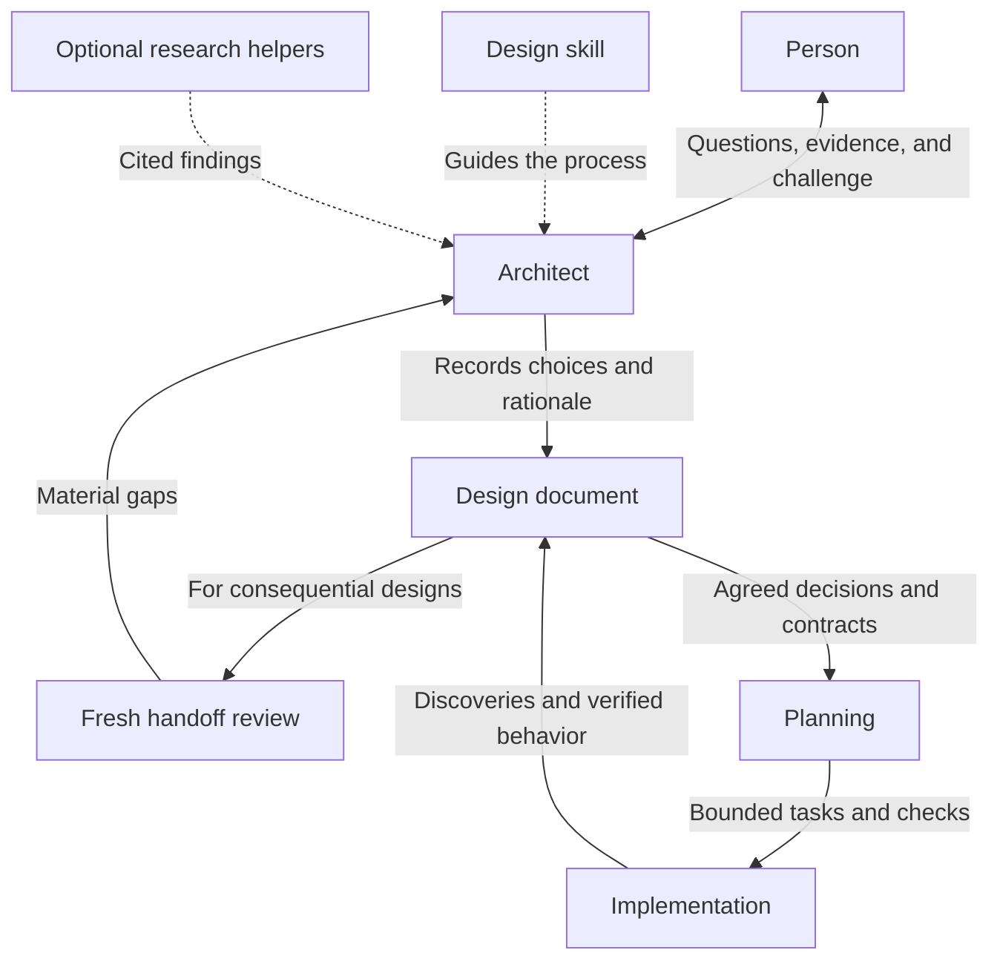

**Research: an architect teammate and a maintained design workflow for Relay**

Reviewed 29 October 2026. This is research input and a set of recommendations. It is not an approved design, implementation plan, or completed role change.

The question is how to combine a collaborative, research-capable architect with a design skill that produces useful documentation for planning, implementation, and later maintenance.

**Finding and evidence quality**

My synthesis is that quality comes from several connected practices: understand the actual system, make requirements concrete, compare real alternatives, expose weaknesses, record decisions, and verify the resulting system. The role prompt should guide judgment. The skill should make the useful work products and checks repeatable.

This review uses primary sources: published agent definitions and workflow templates, official product guidance, first-hand practitioner accounts, and architecture methods from their authors. Source code establishes what a workflow instructs an agent to do. It does not establish that the agent always follows it. Practitioner accounts describe experience, not controlled comparisons. The limited evaluations cited below concern particular behaviors or research tasks; they do not prove which framework produces the best production architecture.

**What coding-agent practitioners and projects actually implement**

| Source | Observed practice | What Relay can take from it |
|---|---|---|
| Anthropic's Feature Dev architect | Its prompt starts from existing code patterns and asks for specific boundaries, interfaces, flows, file references, and implementation details. | Ground recommendations in the repository. A title such as “senior architect” is insufficient without an output contract. [Architect source](https://github.com/anthropics/claude-plugins-official/blob/main/plugins/feature-dev/agents/code-architect.md) |
| Anthropic's Feature Dev workflow | The coordinator obtains alternative proposals from architects with different emphases, compares them, and discusses the choice with the user. | Separate developing a coherent candidate from selecting between candidates. Each candidate needs a rationale; combining all their components is not necessarily a balanced solution. [Workflow source](https://github.com/anthropics/claude-plugins-official/blob/main/plugins/feature-dev/commands/feature-dev.md) |
| GitHub Spec Kit | Its plan template records technical constraints and measurable goals, separates design artifacts from tasks, and asks for justification when a simpler solution is rejected. | Keep architecture decisions distinct from execution tasks. Require a reason for added complexity. [Plan template](https://github.com/github/spec-kit/blob/main/templates/plan-template.md) |
| BMad | Its published method describes file-based handoffs, stable decision identifiers, and an implementation-readiness check. Its documentation treats research and architecture as tools selected for the missing information. | Preserve decisions across agents and sessions. Select the work needed to close a gap. [Published method](https://www.bmadcode.com/method), [planning guidance](https://docs.bmad-method.org/plan/choose-a-planning-path/) |
| Aider | Architect mode separates proposing a code change from translating that proposal into edits. It is a coding mode and can change files. | Distinguish reasoning from editing, but do not confuse this particular mode with the broader architecture practice proposed for Relay. [Chat modes](https://aider.chat/docs/usage/modes.html) |
| Superpowers 7.0.1 | Its release notes describe replacing formulaic questions with context-first exploration and more specific questions. They report fewer skipped design documents in one test scenario after a revision. | Evaluate conversation behavior, including interruptions and premature implementation. Treat the reported experiment as local evidence about compliance, not general proof of software quality. [Release notes](https://github.com/obra/superpowers/releases/tag/v7.0.1) |
| Addy Osmani | His published workflow uses collaborative specification, iterative plan critique, and small implementation steps under human oversight. | The person remains involved in the reasoning. Preserve corrections and decisions before handing work to implementation. [First-hand workflow](https://addyosmani.com/blog/ai-coding-workflow/) |
| Simon Willison and the Claude Code team | Willison uses tests to establish executable context and verify changes. Anthropic's team guide puts particular emphasis on giving agents a way to verify results. | Every significant design claim should have a suitable validation method. This does not imply running a full test suite for every design conversation. [Willison](https://simonwillison.net/guides/agentic-engineering-patterns/first-run-the-tests/), [Claude team practices](https://support.claude.com/en/articles/14554000-claude-code-power-user-tips) |

BMad has multiple development lines. Its repository described V6.12 as stable and main as a preview when inspected. The comparison above concerns the cited published practices; it does not assume identical artifact names or behavior across releases. [Repository status](https://github.com/bmad-code-org/BMAD-METHOD)

The especially useful distinction in Feature Dev is that a worker architect commits to one coherent proposal while the coordinator compares several proposals. There is no contradiction: the roles operate at different levels. For Relay, one interactive architect can compare alternatives itself. Additional independent proposals should be reserved for decisions that justify their cost.

**What established architecture practice adds**

**Architecture as a conversation.** Andrew Harmel-Law's Advice Process asks decision makers to consult people affected by a choice and people with relevant expertise. Advice is recorded, and agreement with every participant is not required. This supports your teammate model: seek disagreement, examine it, then make a reasoned decision. An agent can help identify missing perspectives, but a simulated stakeholder is not evidence of real stakeholder agreement. [Architecture as conversations](https://martinfowler.com/articles/scaling-architecture-conversationally.html)

**Evaluate scenarios and trade-offs.** Carnegie Mellon's ATAM evaluates architecture against quality goals and examines how those goals interact. It identifies risks and decisions sensitive to particular assumptions. Relay can borrow this reasoning without claiming to conduct a full ATAM engagement. Turn “reliable” into a concrete failure scenario, then test each candidate against it. [SEI's ATAM description](https://www.sei.cmu.edu/library/architecture-tradeoff-analysis-method-collection/)

**Explain the proposal before detailing its mechanics.** Rust's RFC template separates an example-driven explanation from the technical reference. It explicitly reconnects the detailed design to the earlier examples and asks about drawbacks, alternatives, prior art, and unresolved questions. This is a close match to your preferred learning style. Prior art is input to the decision, not sufficient justification for copying another system. [Rust RFC template](https://github.com/rust-lang/rfcs/blob/master/0000-template.md)

**Show different views only where useful.** Simon Brown's C4 model provides progressively closer views of a system, with additional runtime and deployment diagrams. Its documentation explicitly says teams need not draw every level. For Relay, begin with the system boundary and major responsibilities; add a sequence diagram to explain actor, trigger, state change, and failure behavior. [C4 diagrams](https://c4model.com/diagrams)

**Include operation and evolution.** Kubernetes' enhancement template asks about tests, rollout, rollback, compatibility, monitoring, dependencies, and failure investigation. It also distinguishes provisional work from implementation-ready proposals. Borrow the applicable questions, scaled to the system. A small library does not need a Kubernetes-sized review process. [Kubernetes enhancement template](https://github.com/kubernetes/enhancements/blob/master/keps/NNNN-kep-template/README.md)

**Preserve reasons as well as structure.** Michael Nygard's decision records capture context, a decision, status, and consequences. Replaced decisions remain discoverable with a link to their successor. This gives a future engineer enough context to reconsider a choice intelligently. The current architecture overview and historical decision record serve different purposes. [Architecture decision records](https://cognitect.com/blog/2011/11/15/documenting-architecture-decisions)

**Keep design connected to implementation.** Arc42 describes an iterative practice in which requirements, structure, shared technical concerns, communication, implementation feedback, and evaluation influence one another. Documentation depth follows the work's needs. A design handoff should therefore permit discoveries to return to the architect and update the design. [Arc42 method](https://arc42.org/method/)

**Make some architectural properties executable.** Kiran Prakash's account of fitness functions describes checks against architectural objectives and shows their use in data-product governance. My proposed transfer to Relay is to turn selected architectural promises into appropriate checks: dependency constraints, contract tests, recovery scenarios, or performance measurements. Automated checks cover specific properties; they do not establish that the entire architecture is good. [Fitness functions in practice](https://martinfowler.com/articles/fitness-functions-data-products.html)

**Recommended responsibilities for Relay**

The following is my proposed synthesis, not a claim that any one source prescribes this exact system.

| Component | Owns | Produces |
|---|---|---|
| Architect role | Technical judgment, collaborative challenge, trade-offs, research interpretation, explanation | A justified recommendation and the decisions needed to proceed |
| Design skill | Choosing an appropriate depth, gathering context, structuring discussion, drafting and reviewing the design | A reviewable architecture document and a clear planning handoff |
| Research guidance | Source quality, version checks, comparable examples, conflicting evidence, uncertainty | Evidence attached to specific decisions |
| Planning skill | Turning the agreed design into bounded tasks, dependencies, ownership, and checks | An executable plan linked to the design |
| Reviewer | Finding significant gaps using the requirements and evidence | Concrete findings with consequences and proposed resolutions |



The review informs whether the handoff is ready; it is not a separate implementation path. Planning proceeds when consequential gaps are resolved or explicitly assigned to later work.

Keep the interactive architect in the conversation so it can work directly with the person. A separate child lead is unnecessary for every question. Existing teacher or reverse-engineer capabilities remain optional. The architect may receive reconstruction evidence without requiring that workflow first.

Use one architect role type for design, planning, and architectural review if clear entry skills keep those responsibilities distinct. For a consequential design, use a fresh review context rather than relying entirely on the design author's self-review. This can reuse an existing role; it does not require inventing another permanent persona. Independent context reduces shared conversational assumptions but does not guarantee independent mistakes.

**The architect's decision method**

1. Establish the actual problem, relevant existing behavior, constraints, and desired result. Ask only about gaps that affect the decision.
2. Identify the few qualities that drive the design. State how they will be judged and where priorities conflict.
3. Describe the simplest credible approach. Where meaningful, compare other viable approaches, including preserving the existing system.
4. Research unresolved questions. Compare external systems by workload, consistency needs, team capacity, operational maturity, and constraints.
5. Walk one example through each serious candidate. Include the failures or changes most likely to distinguish them.
6. Recommend an approach, name its disadvantages, explain rejected alternatives, and state what evidence could change the recommendation.
7. Record consequential decisions and any delegated implementation choices. Give unresolved questions an owner or a proposed experiment.

KISS, DRY, composition, cohesion, coupling, and separation of concerns belong in this judgment process. They should prompt concrete questions: which changes belong together, which dependencies make independent change difficult, and which tests would become easier? They should not cause a pattern to appear without a problem that needs it.

Research should stop when the major options are understood and additional sources are unlikely to change the decision, or when the agreed research budget is exhausted. State remaining uncertainty. A source count is not a quality target. Evidence against the preferred approach deserves deliberate attention.

**Helpers and review**

Keep the previously discussed ceiling of zero to three research helpers, subject to actual host capacity and budget. Use helpers for separable questions, such as mapping existing boundaries, investigating a specific external approach, or challenging a failure scenario. Give each a bounded question and require citations, assumptions, and unresolved issues.

Anthropic's research-system account supports parallel exploration for independent information needs and describes substantial token costs and coordination limitations. Its results concern research workloads, not a proof that more coding agents improve architecture. Relay should decide whether to delegate from the task, rather than starting a fixed team every time. [Multi-agent research account](https://www.anthropic.com/research/multi-agent-research-system)

For larger designs, use a handoff review with a practical question: could a capable engineer make a plan from this document without inventing a consequential decision? Superpowers' builder-check prompt uses this perspective and explicitly excludes choices reasonably left to the builder. [Builder-check source](https://github.com/obra/superpowers/blob/v7.0.1/skills/brainstorming/builder-check-prompt.md)

**Documentation that can be maintained**

Prefer the repository's existing documentation conventions. A possible structure is:

```text
docs/architecture/overview.md       Current system and key flows
docs/architecture/decisions/        Significant decisions and their history
docs/relay/designs/<topic>.md        Proposed or accepted change
docs/relay/plans/<topic>.md          Tasks that implement that change
```

Use a short document for a bounded change. Add detail when interfaces, failure modes, or operational consequences require it. The design should cover the problem, non-goals, constraints, alternatives, chosen responsibilities and contracts, one concrete flow, risks, validation, and the planning handoff. The explanation and technical reference should use the same names and example.

Assign each fact one main home. Plans link to design decisions instead of rewriting their rationale. The overview describes implemented behavior; proposals describe intended behavior. Mark material differences explicitly. Record implementation discoveries and update affected documentation as part of the change that introduced them.

A useful handoff includes:

- Settled architectural decisions and their identifiers or section links.
- Interfaces, data ownership, constraints, and behavior that must remain true.
- Acceptance scenarios and suitable evidence for verifying them.
- Choices intentionally left to the planner or implementer.
- Blocking questions and optional follow-up work, clearly distinguished.
- The design revision and, for existing systems, the inspected code revision when known.

**A concrete example of the reasoning**

Suppose a team asks for a webhook-ingestion service. This example is illustrative; it is not a proposed Relay feature.

The architect first establishes whether events can be repeated, whether acknowledged events may be lost, how long processing takes, and what operations the team can support. A durable queue is a candidate only after those requirements make its benefits relevant.

It compares processing in the request, persisting work for a background worker, and using a managed broker. Each option is examined against the same events: a duplicate delivery, a crash after acceptance, and a slow downstream service. The chosen design states when acknowledgment occurs, who owns retry state, and how repeated delivery affects the result. If an external side effect cannot be made idempotent, the design names that limitation rather than claiming exactly-once processing.

The document then follows one event from receipt to durable acceptance to processing to completion. The plan inherits tests for the required duplicate and crash behavior. Operations receive the relevant monitoring and recovery steps. The decision record states which future change in load or operating needs should cause the team to reconsider the choice.

That makes “balanced architecture” inspectable: we can see the requirement, the trade-off, the decision, and the evidence needed to validate it.

**Implementation implications in the current Relay repository**

Relay 0.3.0 already has an [architect role](../../../roles/architect.md), [planning workflow](../../../skills/relay-plan/SKILL.md), [shared startup rules](../../../skills/using-relay/SKILL.md), and [research guidance](../../../skills/research-and-explain/references/research.md).

The existing architect is restricted to planning and final review, uses a ten-line return limit, and lacks the teacher/reverse-engineer's listed web tools. A design mode needs conversational responses and actual research capabilities. Native host availability still determines which tools it can use.

The complete [research-and-explain skill](../../../skills/research-and-explain/SKILL.md) currently prohibits planning and implementation work and carries learner-specific rules. The architect should not load it wholesale as its workflow. Reuse a suitably separated evidence procedure, while preserving the distinct scopes of teaching, reconstruction, and design.

The initial implementation can use Markdown role and skill sources, templates, and the existing generation pipeline. No new router service, database, or scheduler is justified by this research. Whether any additional deterministic validation is worthwhile should follow observed failures.

OpenAI's skill guidance describes metadata-based selection followed by loading the detailed instructions. Its recent guidance favors concise triggers and references loaded as needed. Apply that structure to a small design entry skill with separate research, documentation, and review references. [Skill activation](https://developers.openai.com/plugins/concepts/skills), [Prompt and skill guidance](https://developers.openai.com/blog/rethinking-skills-and-prompts-for-gpt-6-astra)

Share the semantic workflow between Claude and Codex. Keep host-specific dispatch and tool behavior in the existing host references. Generate role artifacts from source. Automatic selection should recognize requests to design or compare architectures, while a brief conceptual question should remain a teaching or direct-answer task.

**How to establish whether Relay's version works**

OpenAI's evaluation guide recommends checking outcomes, process, style, and efficiency, including explicit, implicit, contextual, and negative-trigger cases. These distinctions directly fit Relay's requirement for contextual activation. [Evaluating skills](https://developers.openai.com/blog/eval-skills)

Start with a small scenario set and repeat it on both harnesses:

| Scenario | Evidence of a useful result |
|---|---|
| “Explain dependency injection” | Answers the concept without starting a project-design workflow. |
| Small change with complete requirements | Gives a proportionate design without redundant research or interviewing. |
| Existing system with a conflicting proposed design | Cites actual boundaries and explains the integration cost. |
| Ambiguous quality requirement | Clarifies a consequential unknown without inventing a target. |
| A fashionable but unjustified architecture | Challenges it with a simpler credible alternative and concrete trade-offs. |
| Contradictory or inaccessible sources | Labels uncertainty and does not manufacture support. |
| Large design | Uses bounded helpers only where they add value; produces a usable handoff. |
| Implementation reveals a mistaken assumption | Revises the design and identifies affected decisions and documentation. |

Use deterministic checks for promised files, links, write boundaries, and explicit workflow transitions. Use human review and a structured rubric for trade-off quality, evidence relevance, completeness, and clarity. Track unnecessary questions, repeated research, elapsed time, and token use. Compare against the current architect and a plain assistant baseline; passing a template check alone is not proof of improvement.

The next design discussion should settle the role's modes, the authority delegated to it, the document conventions, and when an independent handoff review is justified. The evidence supports implementing a compact initial version and improving it against real failures rather than importing an entire external framework.
