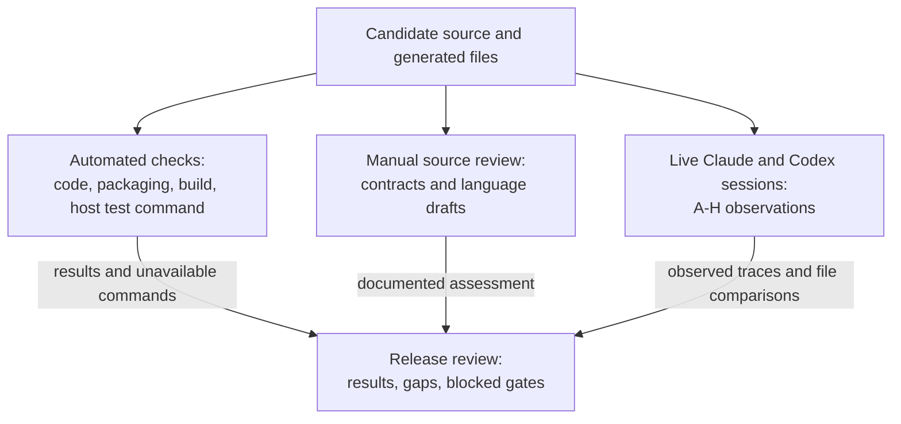

<!-- generated-by: gsd-doc-writer -->
# Testing Relay

Relay checks deterministic code and packaging with automated tests. Manual source review checks instruction contracts and language. Live sessions check how Claude Code and Codex interpret those instructions. A pass in one category does not complete another category.

## Test framework and setup

The main suite uses Node's built-in `node:test` runner and `node:assert/strict`. Its runner version is the active Node.js version; there is no separately versioned test dependency. Run from the repository root with Node.js `>=20` and Git available. The CLI has no runtime dependencies to install. CI uses Node.js 22. [Package scripts](../../package.json), [CI workflow](../../.github/workflows/ci.yml)

Tests live in `test/*.test.mjs`. [test/helpers.mjs](../../test/helpers.mjs) provides `tempRepo()`, `copyFixture()`, `runCli()`, and `runHook()`. CLI tests use actual temporary Git repositories with a local identity and an initial commit. They exercise the CLI and hook processes instead of mocking Git. Fixtures include Markdown plans and fake host executables under [test/fixtures/](../../test/fixtures/).

Claude mod tests use `claude-code/testing` in [hooks/register.test.ts](../../hooks/register.test.ts). They are separate from the Node MJS suite: `npm test` does not execute that TypeScript file. Use the supported Claude plugin-test command for those tests; an unavailable command is a blocked gate, not a pass.

## Running tests

Run the main suite:

```bash
npm test
```

Check generated definitions and portable skill frontmatter without writing files:

```bash
node bin/relay build --check
```

That check compares generated outputs with the role/configuration sources. It also checks skill names, descriptions, and the portable `name` + `description` frontmatter contract. It does not validate natural-language meaning. If generated files are stale, correct their sources and regenerate with `node bin/relay build`. [Build implementation](../../scripts/build.mjs)

For a related subset or one file:

```bash
node --test test/build.test.mjs test/codex-budget.test.mjs test/package.test.mjs
node --test test/worktrees.test.mjs
```

For one named behavior, put Node flags before the file argument:

```bash
node --test --test-name-pattern='both renderers preserve protected literals and role contracts' test/build.test.mjs
node --test --test-name-pattern='research roles receive Relay clean-spawn enforcement and preserve explicit dispatch' test/codex-budget.test.mjs
```

There is no dedicated watch, integration, or end-to-end npm script. `npm test` expands to `node --test test/*.test.mjs`.

When `hooks/register.ts` changes, including its generated routing block, the repository instructions also require:

```bash
claude plugin validate .
claude plugin test .
```

Record the installed host version and actual command result. Validation checks the plugin package; it does not substitute for the mod test runner or a live session. See [AGENTS.md](../../AGENTS.md) and the [current verification record](#current-verification-record).

## Contracts covered by automated tests

| Area | Behavior under test | Source |
|---|---|---|
| Renderers and build | Generated files match sources; Claude metadata and read-only restrictions are retained; Codex definitions leave dispatch model/effort precedence intact; only the marked mod block is replaced. | [build.test.mjs](../../test/build.test.mjs) |
| Budget and dispatch | RPC account-limit reads, separate host stores, weekly-only accounts, unknown/error behavior, usage calibration, clean spawns, explicit arguments, and budget caps. | [codex-budget.test.mjs](../../test/codex-budget.test.mjs), [units.test.mjs](../../test/units.test.mjs) |
| Packaging and setup | Declared resources run outside the checkout without `relay` on PATH; discovery paths resolve; existing configuration is preserved; malformed configuration is rejected; native plugin setup avoids duplicate hooks. | [package.test.mjs](../../test/package.test.mjs) |
| Guards | Repeated test commands on unchanged code are refused; changed code and the documented flaky override are allowed; protected edits are blocked across worktrees and shell/patch forms; errors and lock contention fail open. | [hooks.test.mjs](../../test/hooks.test.mjs), [hook-reliability.test.mjs](../../test/hook-reliability.test.mjs) |
| Plans and lanes | File overlap, dependency order, chains, diamonds, parallel caps, strong-task segments, invalid metadata, and test-budget warnings. | [lanes.test.mjs](../../test/lanes.test.mjs) |
| Worktrees and integration | Slot reuse, commits, merge and review packages, later waves, cleanup, conflict abort, ledger, and protected-test commands in real repositories. | [worktrees.test.mjs](../../test/worktrees.test.mjs) |
| Forecast and progress | Calibration and window boundaries, placeholder estimates, task completion evidence, board escaping, and state updates. | [forecast.test.mjs](../../test/forecast.test.mjs), [board.test.mjs](../../test/board.test.mjs) |
| Unattended runs | Leg classification, deadlines, stalls, stop/resume behavior, and host command arguments through fake host processes. | [marathon.test.mjs](../../test/marathon.test.mjs) |

Two tests were added for the teaching/reverse-engineering integration. The protected-literal renderer fixture checks exact role-body preservation, including a path, command, dispatch fields, status marker, and quotation, while retaining each host's metadata contract. The research-role dispatch test checks that **both** new roles receive clean-spawn recognition: full-history requests are denied and clean requests preserve the explicit model, effort, message, and other arguments under normal usage. Existing package/setup tests were extended to cover the new roles, skills, shared method, references, and relocated discovery.

These tests establish the asserted renderer, hook, and packaging behavior. They do not establish that a host reads every instruction, that a teacher adapts successfully to a learner, or that writing conforms to the full ASD-STE100 standard.

The architect/design change extends existing package tests to cover the shared design skill, its five references, and both generated architect definitions. It checks relocated resource access, Codex fallback discovery, and native setup without duplicate skill links. The existing session-start check also enforces the bootstrap size limit. The [design evaluation](../relay/evaluations/2026-10-30-architect-design.md) records these checks and a separate behavioral exercise.

## Writing new tests

Follow [qa-mindset](../../skills/qa-mindset/SKILL.md). Name files `*.test.mjs` under `test/`; use the shared helpers for CLI/hook behavior and real temporary repositories for Git behavior. Derive expected values from the spec or brief, exercise public behavior, and use exact assertions. Add a test only for a failure an existing check does not catch.

See a new test fail for the intended reason before trusting it, either before implementation or through a deliberate, scoped mutation. Restore the source exactly afterward. The recorded renderer fixture rejected a deliberate path mutation and passed again after restoration; that is evidence for its protected-literal assertion, not a general language check. [Dated evaluation record](../relay/evaluations/2026-10-25-teaching-and-reverse-engineering.md)

Acceptance tests come from the spec through the test-author role before or independently of implementation. Protect them with the existing workflow. Do not edit, weaken, skip, or delete a protected test to obtain a pass. If a test conflicts with the spec, report the spec line, expected behavior, and observed behavior. For high-risk work, the QA policy calls for mutation testing on changed lines after green; the repository does not configure a universal mutation-runner command.

Run the narrowest relevant check first. Reuse results for unchanged code. During plan execution, the full suite runs once per wave in integration through `relay worktrees merge <plan> --wave N --suite`, using the plan's suite command. Do not add repeated full-suite runs inside lanes. Use `RELAY_RERUN=1` only for a genuinely flaky rerun and record the reason. Final repository checks still follow [AGENTS.md](../../AGENTS.md).

## Coverage requirements

No coverage threshold configured. There is no Jest/Vitest/nyc/c8 coverage configuration or coverage script in the repository.

| Type | Threshold |
|---|---|
| Lines | Not configured |
| Branches | Not configured |
| Functions | Not configured |
| Statements | Not configured |

The QA policy measures whether a test catches the relevant failure. A coverage percentage does not replace that check.

## CI integration

The [`ci` workflow](../../.github/workflows/ci.yml), job `test`, runs on pushes and pull requests using `ubuntu-latest` and Node.js 22. After checkout and a Git identity setup, it runs `npm test` followed by `node bin/relay build --check`. It does not run Claude plugin validation, Claude mod tests, manual language review, or the live research matrix.

## Manual and live evaluation



Manual review compares source and generated instructions with the previous contracts: tools, tiers, turn limits, write boundaries, output markers, stops, and protected literals. Review wording against the [language guide](../../skills/using-relay/references/language-guide.md) and [glossary](../../skills/using-relay/references/software-glossary.md). Record a strict STE-style draft assessment separately from automated checks. A source review does not demonstrate an actual learner response.

Use the [dated both-host A–H recipe and source-review ledger](../relay/evaluations/2026-10-25-teaching-and-reverse-engineering.md) for independent teaching/reconstruction, adaptation, focus and invalid inputs, source access, helper capacity, handoff/report scope, language delivery, and existing-role regression. The recipe contains the fixture and exact variations; this guide does not duplicate them.

For each live case, record the candidate commit, actual host/version, entry path, available tools and global capacity, request, response and dispatch trace, citations, and before/after file comparison. Mark observed results PASS or FAIL. Mark missing host/tool prerequisites BLOCKED with the reason. Unattempted cases remain UNEXECUTED. A static pass never changes a live row to PASS.

## Current verification record

The **2026-10-30** architect/design implementation and documentation follow-up use Node.js **v20.11.0**, with working-tree changes based on `1164e7ec1e9096b0af89fb8058b1ae59849da188`. The [dated evaluation](../relay/evaluations/2026-10-30-architect-design.md) records implementation checks and an isolated behavioral exercise. The documentation follow-up changes no runtime instructions and adds or removes no tests.

| Check | Result and scope |
|---|---|
| `npm test` | PASS: 93/93, zero failures or skipped tests; rerun for the documentation follow-up. |
| `node bin/relay build --check` | PASS: generated files current; shared skill frontmatter portable. |
| Plugin manifest validation | PASS during implementation with Claude Code 2.1.27. Root marketplace validation retains its existing description warning. Not rerun for the documentation-only follow-up. |
| Isolated design exercise | Completed with a fresh Codex subagent loading source instructions directly. Produced the requested document and observed scope boundaries. This was not installed-plugin discovery or native-role validation. |
| Skill creator validator | Could not start because PyYAML was unavailable. Relay's own portable-skill checks passed. |
| Claude mod tests | Not rerun: this feature and documentation follow-up do not change `hooks/register.ts`. The historical host-command limitation is recorded below. |
| Installed design scenarios, both hosts | UNEXECUTED; see the dated evaluation for selection, research, helper, review, document-update, and planning-handoff cases. |
| Teaching/reconstruction cases A–H, both hosts | Remain UNEXECUTED in their separate evaluation record. |

## Historical verification records

Fresh checks on **2026-10-26** used Node.js **v20.11.0** at integration HEAD `3dec0332c4e70815a68697b4d6bc0e93c7bcabb9` plus the documentation working-tree changes. This includes the final architect-description restorations. The documentation update added no tests and removed no tests. Claude commands were not rerun for this documentation-only update.

| Check | 2026-10-26 result |
|---|---|
| `npm test` | PASS: 93/93, zero failures, zero skipped tests. |
| `node bin/relay build --check` | PASS: generated files current; skills portable. |
| `claude plugin validate .` | Not rerun; historical PASS with warning, as described below. |
| `claude plugin test .` | Not rerun; historical host command is BLOCKED as described below. |
| Live cases A–H, Claude Code and Codex | All UNEXECUTED in the dated evaluation record. |

The **2026-10-25 historical integration record** reports 93/93 Node tests at `2b955f3`. That run preceded three final architect-description restorations in the role source and its two generated forms. Build consistency and Claude plugin validation passed for integration `3dec033` and its identical verified tree. These are historical results, with that scope limitation.

In the recorded environment, Claude Code **2.1.27** rejected `claude plugin test .` with `error: unknown command 'test'` and exit 1. That required host gate remains **BLOCKED**. Plugin validation passed with the pre-existing marketplace `metadata.description` warning. Neither the warning-bearing validation pass nor the Node suite substitutes for the unavailable command. The [evaluation record](../relay/evaluations/2026-10-25-teaching-and-reverse-engineering.md) retains this limitation and all unexecuted live rows.

See [development](../guides/development.md) for source/build boundaries, [configuration](../configuration/README.md) for routing consumers, and the [architecture](../architecture/overview.md) for the flow these contracts protect.
